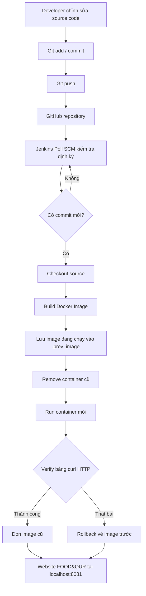

# CONFIGURE AND DEPLOY DEVOPS SERVICES IN LINUX
## Tài liệu dự án và hướng dẫn triển khai CI/CD website FOOD&OUR

> Tài liệu này mô tả quy trình xây dựng môi trường DevOps trên Linux: đóng gói website bằng Docker, phục vụ bằng Nginx, tự động build/deploy bằng Jenkins, chỉnh tham số cấu hình bằng shell script, quản lý vòng đời container (rollback, dọn image, healthcheck) và triển khai trên Kubernetes (minikube).
>
> Repository: https://github.com/ManchesterUnited-22/devops_configure  
> Jenkins job: `food-our-cicd`  
> Website sau triển khai (Docker): `http://localhost:8081/`  
> Jenkins: `http://localhost:8080/`  
> Website trên Kubernetes (minikube): lấy địa chỉ bằng `minikube service food-our --url`

---

## Mục lục

1. Giới thiệu dự án
2. Kiến trúc tổng thể
3. Chuẩn bị môi trường
4. Đưa source code lên GitHub
5. Đóng gói website bằng Docker
6. Xây dựng Jenkins Pipeline
7. Cấu hình tự động phát hiện thay đổi bằng Poll SCM
8. Kiểm tra trạng thái triển khai
9. Script chỉnh tham số cấu hình
10. Quản lý container: rollback, dọn image, healthcheck
11. Triển khai trên Kubernetes (minikube)
12. Khởi động lại môi trường và kịch bản demo
13. Các lỗi đã gặp và cách xử lý
14. Quy trình triển khai lại dành cho thành viên nhóm
15. Kết quả đạt được
16. Lưu ý vận hành và bảo mật
17. Kết luận

---

# Tóm tắt nhanh

| Thuộc tính | Giá trị |
|---|---|
| Git repository | `ManchesterUnited-22/devops_configure` |
| Branch | `main` |
| Jenkins URL | `http://localhost:8080` |
| Jenkins job | `food-our-cicd` |
| Website (Docker) | `http://localhost:8081/` |
| Website kiểm thử thủ công | `http://localhost:8082/` |
| Docker image | `food-our-web` |
| Container chính | `food-our-container` |
| Poll SCM | `H/2 * * * *` |
| Script chỉnh tham số | `scripts/configure.sh` |
| Manifest Kubernetes | `k8s/deployment.yaml` (Deployment + Service NodePort `30081`) |
| Môi trường | Ubuntu 24.04 trên WSL2, thao tác qua terminal VS Code (Remote - WSL) |

---

# 1. Giới thiệu dự án

## 1.1. Tên đề tài

**Configure and Deploy DevOps Services in Linux**

## 1.2. Mục tiêu

Mục tiêu của dự án là thiết lập và sử dụng các dịch vụ DevOps trên môi trường Linux để triển khai một website có sẵn. Trọng tâm không phải phát triển một website mới, mà là xây dựng quy trình quản lý mã nguồn, đóng gói, triển khai, cấu hình, quản lý container và kiểm tra ứng dụng.

Sau khi hoàn thành, quy trình hoạt động như sau:

1. Lập trình viên chỉnh sửa mã nguồn website.
2. Lập trình viên commit và push thay đổi lên GitHub.
3. Jenkins định kỳ kiểm tra repository thông qua Poll SCM.
4. Khi phát hiện commit mới, Jenkins tự khởi chạy Pipeline.
5. Jenkins lấy mã nguồn mới nhất từ GitHub.
6. Jenkins build Docker image.
7. Jenkins lưu lại image đang chạy (để rollback), rồi thay thế container bằng container mới.
8. Jenkins kiểm tra website thông qua HTTP request.
9. Jenkins dọn các image cũ, chỉ giữ lại một số bản gần nhất.
10. Nếu Pipeline thất bại, Jenkins tự rollback về phiên bản trước.
11. Người dùng truy cập website tại `http://localhost:8081/`.

Ngoài luồng CI/CD, dự án còn có:

- Script `scripts/configure.sh` để thay đổi tham số cấu hình (cổng, tên container, tên image, cấu hình Nginx, số replicas) một cách an toàn.
- Bộ manifest Kubernetes để triển khai, scale, cập nhật cuốn chiếu (rolling update) và rollback website trên minikube.

## 1.3. Phạm vi

Dự án sử dụng website FOOD&OUR đã có sẵn. Website được đóng gói và triển khai dưới dạng nội dung tĩnh bằng Nginx.

Các chức năng phụ thuộc backend PHP hoặc cơ sở dữ liệu (nếu có trong source ban đầu) không nằm trong phạm vi triển khai hiện tại. Vì vậy, những chức năng cần xử lý dữ liệu phía server như đăng nhập, giỏ hàng hoặc đặt hàng có thể không hoạt động đầy đủ. Phạm vi demo tập trung vào việc phục vụ giao diện HTML, CSS, JavaScript và hình ảnh.

Phần Kubernetes được thực hiện thủ công bằng `kubectl` và `minikube` trên cùng máy, chưa được tích hợp vào Jenkins Pipeline.

## 1.4. Đối chiếu với yêu cầu của đề

| Yêu cầu của đề | Nội dung thực hiện trong dự án |
|---|---|
| 1.1. Nghiên cứu dịch vụ server trên Ubuntu | Nghiên cứu, cài đặt, cấu hình Jenkins, Nginx, Git, Docker trên Ubuntu |
| 1.1. Viết shell script đổi tham số cấu hình của dịch vụ | `scripts/configure.sh` (mục 9): đổi cổng, tên container, tên image, `server_name`, `client_max_body_size`, số replicas; có backup, kiểm tra đầu vào, kiểm tra cú pháp Nginx, khôi phục |
| 1.3. Nghiên cứu nền tảng ảo hóa/container | Docker, Nginx container, so sánh với Kubernetes (mục 5, 11) |
| 1.3. Triển khai và quản lý container | Docker + Jenkins (mục 6, 10) và Kubernetes/minikube: Deployment, Service, scale, rolling update, rollback (mục 11) |
| 1.2. Mã nguồn mở, tự biên dịch | Không thuộc phạm vi dự án này |
| 1.4. Agentic AI, MCP, Linux automation | Không thuộc phạm vi dự án này |

---

# 2. Kiến trúc tổng thể

## 2.1. Các thành phần

| Thành phần | Vai trò |
|---|---|
| Ubuntu 24.04 trên WSL2 | Môi trường Linux để thao tác và chạy Jenkins |
| VS Code (Remote - WSL) | Soạn code và mở terminal trực tiếp trong Ubuntu WSL |
| Git | Quản lý phiên bản mã nguồn |
| GitHub | Lưu trữ repository từ xa |
| Java 21 | Môi trường chạy Jenkins |
| Jenkins LTS | Điều phối quy trình CI/CD |
| Docker Desktop + WSL2 integration | Cung cấp Docker Engine để build image và chạy container |
| Dockerfile | Mô tả cách đóng gói website thành image |
| Nginx | Web server phục vụ nội dung tĩnh |
| Jenkinsfile | Khai báo các stage trong Jenkins Pipeline |
| `scripts/configure.sh` | Script chỉnh tham số cấu hình |
| kubectl + minikube | Chạy cụm Kubernetes cục bộ và quản lý ứng dụng |
| `k8s/deployment.yaml` | Khai báo Deployment và Service cho Kubernetes |

## 2.2. Sơ đồ quy trình



## 2.3. Luồng triển khai

- GitHub là nơi lưu mã nguồn trung tâm.
- Jenkins lấy source từ nhánh `main`.
- Docker image được build từ Dockerfile trong repository.
- Container chính có tên `food-our-container`.
- Website được ánh xạ cổng máy host `8081` vào cổng `80` bên trong container.
- Nginx tiếp nhận HTTP request và trả về file website.
- Song song, cùng image đó có thể được nạp vào minikube để chạy dưới dạng Deployment nhiều replicas.

---

# 3. Chuẩn bị môi trường

## 3.1. Môi trường sử dụng

Trong quá trình triển khai dự án, môi trường được sử dụng:

- Windows 11.
- Ubuntu 24.04 chạy trên WSL2, thao tác qua terminal của VS Code (extension WSL).
- Java 21.
- Jenkins LTS 2.580.2.
- Docker Desktop có bật WSL Integration.
- Git và GitHub.
- kubectl và minikube (driver `docker`) cho phần Kubernetes.

> Lưu ý: Có thể triển khai trên Ubuntu cài trực tiếp hoặc máy ảo VirtualBox. Tuy nhiên, các lệnh và đường dẫn trong tài liệu này được viết theo môi trường Ubuntu WSL2. Nếu sử dụng VirtualBox, cần điều chỉnh địa chỉ truy cập và cấu hình mạng tương ứng.

Kiểm tra terminal đang thật sự là Ubuntu WSL (không phải PowerShell):

```bash
cat /etc/os-release   # phải thấy Ubuntu 24.04
uname -r              # phải có chữ microsoft-standard-WSL2
```

Góc dưới bên trái của VS Code hiển thị `WSL: Ubuntu-24.04`.

## 3.2. Cập nhật Ubuntu

```bash
sudo apt update
sudo apt upgrade -y
```

## 3.3. Cài Java 21

Kiểm tra Java:

```bash
java --version
```

Nếu chưa có Java 21:

```bash
sudo apt install openjdk-21-jdk -y
```

Kiểm tra lại:

```bash
java --version
```

Jenkins cần Java để khởi chạy. Trong dự án này, Java 21 được sử dụng làm runtime cho Jenkins.

## 3.4. Cài Jenkins LTS

Jenkins được cài từ repository Debian chính thức của Jenkins. Các lệnh cài đặt có thể thay đổi theo phiên bản Jenkins và hướng dẫn chính thức tại thời điểm cài đặt.

Kiểm tra dịch vụ:

```bash
sudo systemctl status jenkins
```

Nếu cần khởi động:

```bash
sudo systemctl start jenkins
```

Cho Jenkins tự khởi động cùng hệ thống:

```bash
sudo systemctl enable jenkins
```

Truy cập Jenkins:

```text
http://localhost:8080
```

Nếu Jenkins yêu cầu initial administrator password:

```bash
sudo cat /var/lib/jenkins/secrets/initialAdminPassword
```

Sao chép mật khẩu hiển thị vào trang Jenkins và hoàn thành các bước cài đặt ban đầu.

> Không đưa mật khẩu Jenkins, token GitHub, private key hoặc thông tin xác thực vào README hay repository công khai.

## 3.5. Cài Git

```bash
sudo apt install git -y
git --version
```

Thiết lập danh tính Git:

```bash
git config --global user.name "Your Name"
git config --global user.email "your-email@example.com"
```

Thay tên và email bằng thông tin GitHub của thành viên thực hiện commit.

## 3.6. Cài Docker Desktop và tích hợp WSL2

Trong dự án, Docker Engine được cung cấp bởi Docker Desktop trên Windows.

Các bước tổng quát:

1. Cài Docker Desktop trên Windows.
2. Mở Docker Desktop.
3. Vào Settings.
4. Bật WSL 2 based engine nếu tùy chọn này có trên phiên bản đang dùng.
5. Vào Resources → WSL Integration.
6. Bật tích hợp cho Ubuntu đang sử dụng.
7. Apply/Restart nếu được yêu cầu.
8. Mở lại terminal Ubuntu.

Kiểm tra Docker:

```bash
docker --version
docker info
```

Kiểm tra khả năng chạy container:

```bash
docker run --rm hello-world
```

Nếu Ubuntu báo không tìm thấy lệnh `docker`, hãy kiểm tra WSL Integration trong Docker Desktop và mở lại terminal.

## 3.7. Cho Jenkins quyền sử dụng Docker

Trong môi trường triển khai đã cấu hình, Jenkins cần có quyền gọi lệnh Docker.

Kiểm tra group Docker:

```bash
getent group docker
```

Thêm tài khoản Jenkins vào group Docker:

```bash
sudo usermod -aG docker jenkins
```

Khởi động lại Jenkins:

```bash
sudo systemctl restart jenkins
```

Kiểm tra Jenkins có thể gọi Docker bằng một Jenkins job kiểm tra môi trường hoặc bằng Pipeline thử nghiệm.

> Lưu ý bảo mật: Thành viên thuộc group `docker` có quyền rất cao trên Docker host, trong nhiều cấu hình tương đương quyền root. Chỉ cấp quyền cho tài khoản đáng tin cậy và không áp dụng tùy tiện trên máy chủ production.

## 3.8. Bật systemd trong WSL

Jenkins chạy bằng `systemctl`, nên WSL phải bật systemd. Kiểm tra file `/etc/wsl.conf`:

```ini
[boot]
systemd=true
```

Nếu thiếu, thêm vào, sau đó ở PowerShell (Windows) chạy `wsl --shutdown`, mở lại Ubuntu và khởi động lại Jenkins:

```bash
sudo systemctl start jenkins
```

Jenkins cần 1–2 phút để khởi động xong sau mỗi lần bật máy.

---

# 4. Đưa source code lên GitHub

## 4.1. Clone repository

```bash
git clone https://github.com/ManchesterUnited-22/devops_configure.git
cd devops_configure
```

Nếu repository đã có trên máy:

```bash
cd ~/devops_configure
git status
```

## 4.2. Cấu trúc source liên quan

Cấu trúc dự án có các thư mục và file chính như sau:

```text
devops_configure/
├── HTML/
│   ├── Home.html
│   ├── Food.html
│   └── ...
├── Source/
│   ├── Header.css
│   ├── Footer.css
│   ├── Food.css
│   ├── Food.js
│   └── ...
├── Img/
│   └── ...
├── Img1/
│   └── ...
├── Php/                      # backend PHP gốc, không chạy trong bản deploy tĩnh
├── nginx/
│   └── default.conf
├── scripts/
│   └── configure.sh          # script chỉnh tham số cấu hình
├── k8s/
│   └── deployment.yaml       # Deployment + Service cho Kubernetes
├── Dockerfile
├── .dockerignore
├── .gitignore
├── Jenkinsfile
└── README.md
```

Cấu trúc thực tế có thể có thêm các thư mục hoặc file khác. Điều quan trọng là Docker build context phải chứa các tài nguyên mà website tham chiếu.

## 4.3. Kiểm tra đường dẫn hình ảnh

Trong quá trình kiểm thử, website đã có một số thẻ `` tham chiếu đến tên file không tồn tại hoặc sai chữ hoa/chữ thường, sai phần mở rộng.

Để kiểm tra các ảnh nội bộ trong các file HTML thuộc thư mục `HTML/`, chạy tại thư mục gốc repository:

```bash
python3 - <<'PY'
import re
from pathlib import Path

missing = []

for html in Path("HTML").glob("*.html"):
    content = html.read_text(encoding="utf-8", errors="ignore")

    for src in re.findall(r']+src=["\']([^"\']+)["\']', content, re.I):
        if src.startswith(("http://", "https://", "data:")):
            continue

        if src.startswith("/"):
            path = Path(".") / src.lstrip("/")
        else:
            path = html.parent / src

        if not path.is_file():
            missing.append((html, src))

print("SỐ ẢNH NỘI BỘ BỊ THIẾU:", len(missing))

for html, src in missing:
    print(f"[MISSING] {html} -> {src}")
PY
```

Kết quả mong đợi sau khi sửa:

```text
SỐ ẢNH NỘI BỘ BỊ THIẾU: 0
```

Nếu có ảnh bị thiếu, kiểm tra tên file thật trong `Img/` hoặc `Img1/`, sau đó sửa `src` trong HTML cho khớp. Trên Linux, tên file có phân biệt chữ hoa/chữ thường.

## 4.4. Commit và push source

```bash
git status
git add .
git commit -m "Prepare website for Docker deployment"
git push origin main
```

Các lần cập nhật sau:

```bash
git add .
git commit -m "Describe the change"
git push origin main
```

> Dùng `git --no-pager diff` để in thay đổi thẳng ra terminal. Lệnh `git diff` thường mở chế độ xem từng trang (hiện dấu `:` ở cuối màn hình); nhấn `q` để thoát.

## 4.5. File `.gitignore`

Các file sinh ra trong quá trình vận hành không nên đưa lên GitHub:

```text
.config-backup/
.prev_image
```

---

# 5. Đóng gói website bằng Docker

## 5.1. Vì sao sử dụng Docker?

Docker cho phép đóng gói website cùng môi trường chạy cần thiết thành image. Nhờ đó, website có thể chạy nhất quán trong container mà không cần cài Nginx trực tiếp vào hệ điều hành host.

Trong dự án:

- Image: `food-our-web`
- Container chính: `food-our-container`
- Cổng host: `8081`
- Cổng container: `80`

## 5.2. Tạo Dockerfile

Tại thư mục gốc repository, tạo file `Dockerfile`:

```dockerfile
FROM nginx:alpine

COPY . /usr/share/nginx/html/

COPY nginx/default.conf /etc/nginx/conf.d/default.conf

HEALTHCHECK --interval=30s --timeout=3s --retries=3 \
  CMD wget -qO- http://127.0.0.1/ >/dev/null || exit 1

EXPOSE 80
```

Giải thích:

| Chỉ thị | Ý nghĩa |
|---|---|
| `FROM nginx:alpine` | Dùng image Nginx phiên bản Alpine làm image nền |
| `COPY . /usr/share/nginx/html/` | Sao chép source website vào thư mục phục vụ nội dung của Nginx |
| `COPY nginx/default.conf ...` | Thay cấu hình server mặc định bằng cấu hình của dự án |
| `HEALTHCHECK ...` | Docker tự kiểm tra website bên trong container mỗi 30 giây; thất bại 3 lần liên tiếp thì container được đánh dấu `unhealthy` |
| `EXPOSE 80` | Khai báo cổng mà Nginx sử dụng bên trong container |

`EXPOSE 80` là thông tin mô tả cổng; việc publish cổng ra host được thực hiện bằng tùy chọn `-p` khi chạy `docker run`.

Healthcheck dùng `127.0.0.1` thay vì `localhost` vì Nginx trong cấu hình này chỉ lắng nghe IPv4.

## 5.3. Tạo `.dockerignore`

File `.dockerignore` giúp loại bỏ những nội dung không cần thiết khỏi Docker build context (và khỏi image).

Nội dung:

```text
.git
.gitignore
README.md
.config-backup
.prev_image
scripts
k8s
```

`scripts/` và `k8s/` chỉ dùng để vận hành, không cần nằm trong image website. Thư mục `nginx/` không được loại bỏ vì Dockerfile cần `nginx/default.conf`.

## 5.4. Cấu hình Nginx

Tạo thư mục và file:

```bash
mkdir -p nginx
nano nginx/default.conf
```

Nội dung cấu hình:

```nginx
server {
    listen 80;
    server_name localhost;

    root /usr/share/nginx/html;
    index HTML/Home.html;

    location / {
        try_files $uri $uri/ /HTML/$uri /HTML/Home.html;
    }
}
```

Giải thích:

- `listen 80`: Nginx lắng nghe cổng 80 trong container.
- `server_name localhost`: tên server cho cấu hình này.
- `root /usr/share/nginx/html`: thư mục gốc chứa source đã được Docker COPY vào.
- `index HTML/Home.html`: trang mặc định là `HTML/Home.html`.
- `location /`: xử lý request bắt đầu từ đường dẫn gốc.
- `try_files`: thử tìm file/thư mục tương ứng; nếu không tìm thấy thì thử đường dẫn trong `HTML/`, cuối cùng fallback về trang chủ.

Cấu hình này phù hợp với cấu trúc dự án có file HTML nằm trong thư mục `HTML/`, trong khi `Img/`, `Img1/` và `Source/` nằm ở thư mục gốc.

Các tham số `server_name` và `client_max_body_size` có thể được thay đổi an toàn bằng `scripts/configure.sh` (mục 9).

## 5.5. Build Docker image thủ công để kiểm tra

Từ thư mục gốc repository:

```bash
docker build -t food-our-web:test .
```

Kiểm tra image:

```bash
docker images
```

Chạy container kiểm thử:

```bash
docker rm -f food-our-test 2>/dev/null || true

docker run -d \
  --name food-our-test \
  -p 8082:80 \
  food-our-web:test
```

Kiểm tra:

```bash
docker ps
```

Mở trình duyệt:

```text
http://localhost:8082/
```

Kiểm tra trang chủ, trang Food, CSS, JavaScript và hình ảnh. Khi đã xác nhận bản test hoạt động, có thể dọn container test:

```bash
docker rm -f food-our-test
```

---

# 6. Xây dựng Jenkins Pipeline

## 6.1. Jenkins Pipeline là gì?

Jenkins Pipeline là quy trình tự động hóa được khai báo dưới dạng mã. Trong dự án, Pipeline được lưu trong file `Jenkinsfile` tại thư mục gốc repository.

Pipeline gồm năm stage:

1. Checkout.
2. Build Docker Image.
3. Deploy Container.
4. Verify Deployment.
5. Cleanup Old Images.

Ngoài ra, khối `post` có cơ chế tự động rollback khi Pipeline thất bại.

## 6.2. Nội dung Jenkinsfile

File `Jenkinsfile`:

```groovy
pipeline {
    agent any

    options {
        timestamps()
    }

    environment {
        IMAGE_NAME = 'food-our-web'
        CONTAINER_NAME = 'food-our-container'
        HOST_PORT = '8081'
    }

    stages {
        stage('Checkout') {
            steps {
                echo 'Getting source code from GitHub...'
                checkout scm
                sh 'rm -f .prev_image'
            }
        }

        stage('Build Docker Image') {
            steps {
                echo 'Building Docker image...'
                sh '''
                    docker build -t ${IMAGE_NAME}:${BUILD_NUMBER} .
                    docker tag ${IMAGE_NAME}:${BUILD_NUMBER} ${IMAGE_NAME}:latest
                '''
            }
        }

        stage('Deploy Container') {
            steps {
                echo 'Deploying website...'
                sh '''
                    docker inspect -f '{{.Config.Image}}' ${CONTAINER_NAME} > .prev_image 2>/dev/null || true

                    docker rm -f ${CONTAINER_NAME} || true

                    docker run -d \
                        --name ${CONTAINER_NAME} \
                        --restart unless-stopped \
                        -p ${HOST_PORT}:80 \
                        ${IMAGE_NAME}:${BUILD_NUMBER}
                '''
            }
        }

        stage('Verify Deployment') {
            steps {
                echo 'Checking website availability...'
                sh '''
                    curl --retry 5 \
                         --retry-connrefused \
                         --retry-delay 2 \
                         -f http://localhost:${HOST_PORT}/
                '''
            }
        }

        stage('Cleanup Old Images') {
            steps {
                echo 'Removing old images (keeping the 3 latest builds)...'
                sh '''
                    docker images ${IMAGE_NAME} --format '{{.Tag}}' \
                      | grep -E '^[0-9]+$' | sort -rn | tail -n +4 \
                      | xargs -r -I{} docker rmi ${IMAGE_NAME}:{} || true
                '''
            }
        }
    }

    post {
        success {
            echo 'Deployment completed successfully!'
        }

        failure {
            echo 'Pipeline failed. Rolling back...'
            sh '''
                if [ -s .prev_image ]; then
                    PREV=$(cat .prev_image)
                    docker rm -f ${CONTAINER_NAME} || true
                    docker run -d --name ${CONTAINER_NAME} --restart unless-stopped \
                        -p ${HOST_PORT}:80 "$PREV"
                    echo "Đã rollback về $PREV"
                else
                    echo "Không có phiên bản trước để rollback"
                fi
            '''
        }
    }
}
```

## 6.3. Giải thích Jenkinsfile

### Khai báo Pipeline

```groovy
pipeline {
    agent any
```

`pipeline` khai báo một Declarative Pipeline. `agent any` cho phép Jenkins chọn agent phù hợp để chạy Pipeline. Trong cấu hình hiện tại, job chạy trên Jenkins node đang có quyền truy cập Docker.

### Timestamps

```groovy
options {
    timestamps()
}
```

Hiển thị thời gian ở các dòng log để dễ theo dõi quá trình thực thi.

### Biến môi trường

```groovy
environment {
    IMAGE_NAME = 'food-our-web'
    CONTAINER_NAME = 'food-our-container'
    HOST_PORT = '8081'
}
```

- `IMAGE_NAME`: tên image.
- `CONTAINER_NAME`: tên container triển khai chính.
- `HOST_PORT`: cổng host dùng để truy cập website.

Ba giá trị này có thể được đổi bằng `scripts/configure.sh` (mục 9).

### Stage 1: Checkout

```groovy
stage('Checkout') {
    steps {
        echo 'Getting source code from GitHub...'
        checkout scm
        sh 'rm -f .prev_image'
    }
}
```

Lấy source code từ repository và branch đã khai báo trong cấu hình job Jenkins. `checkout scm` sử dụng cấu hình SCM của chính job. Dòng `rm -f .prev_image` xóa dấu vết rollback của lần build trước, tránh dùng nhầm thông tin cũ.

### Stage 2: Build Docker Image

```groovy
docker build -t ${IMAGE_NAME}:${BUILD_NUMBER} .
docker tag ${IMAGE_NAME}:${BUILD_NUMBER} ${IMAGE_NAME}:latest
```

- Build image từ Dockerfile ở thư mục hiện tại.
- `BUILD_NUMBER` là số thứ tự build do Jenkins cấp.
- Tag `latest` trỏ đến image vừa build.

Ví dụ, ở build số 2, image có tag `food-our-web:2`.

### Stage 3: Deploy Container

```groovy
docker inspect -f '{{.Config.Image}}' ${CONTAINER_NAME} > .prev_image 2>/dev/null || true
```

Ghi lại tên image mà container hiện tại đang chạy vào file `.prev_image`. Nếu chưa có container thì file rỗng. Thông tin này dùng cho rollback.

```groovy
docker rm -f ${CONTAINER_NAME} || true
```

Xóa container cũ nếu tồn tại. `|| true` giúp lệnh không làm Pipeline thất bại khi chưa có container cũ.

```groovy
docker run -d \
    --name ${CONTAINER_NAME} \
    --restart unless-stopped \
    -p ${HOST_PORT}:80 \
    ${IMAGE_NAME}:${BUILD_NUMBER}
```

- `-d`: chạy container nền.
- `--name`: đặt tên container.
- `--restart unless-stopped`: tự khởi động lại container khi phù hợp, trừ khi bị người quản trị chủ động dừng.
- `-p 8081:80`: ánh xạ cổng 8081 trên host vào cổng 80 trong container.
- Dùng image gắn với số build hiện tại.

### Stage 4: Verify Deployment

```groovy
curl --retry 5 \
     --retry-connrefused \
     --retry-delay 2 \
     -f http://localhost:${HOST_PORT}/
```

Gửi HTTP request đến website vừa triển khai.

- `--retry 5`: thử lại tối đa 5 lần khi có lỗi phù hợp.
- `--retry-connrefused`: thử lại nếu kết nối bị từ chối.
- `--retry-delay 2`: chờ 2 giây giữa các lần thử.
- `-f`: trả về lỗi nếu server phản hồi HTTP status lỗi.

Nếu request thành công, stage Verify Deployment thành công.

> Kiểm tra HTTP bằng `curl -f` xác nhận endpoint phản hồi thành công ở mức HTTP. Nó không thay thế kiểm thử giao diện trình duyệt hoặc kiểm thử từng chức năng ứng dụng.

### Stage 5: Cleanup Old Images

```groovy
docker images ${IMAGE_NAME} --format '{{.Tag}}' \
  | grep -E '^[0-9]+$' | sort -rn | tail -n +4 \
  | xargs -r -I{} docker rmi ${IMAGE_NAME}:{} || true
```

Liệt kê các tag dạng số build của image, sắp xếp giảm dần, bỏ qua 3 bản mới nhất và xóa phần còn lại. Image đang được container sử dụng không bị xóa (Docker từ chối), và lỗi đó được bỏ qua nhờ `|| true`. Việc giữ lại 3 bản gần nhất đảm bảo luôn còn image để rollback.

### Post actions

- `success`: ghi log khi Pipeline thành công.
- `failure`: tự động rollback (chi tiết ở mục 10.1).

## 6.4. Tạo Pipeline job trong Jenkins

Truy cập:

```text
http://localhost:8080
```

Thực hiện:

1. Chọn **New Item**.
2. Đặt tên `food-our-cicd`.
3. Chọn loại **Pipeline**.
4. Nhấn OK.
5. Trong cấu hình job, tìm mục Pipeline.
6. Chọn **Pipeline script from SCM**.
7. SCM: chọn **Git**.
8. Repository URL:

   ```text
   https://github.com/ManchesterUnited-22/devops_configure.git
   ```

9. Branch Specifier:

   ```text
   */main
   ```

10. Script Path:

    ```text
    Jenkinsfile
    ```

11. Lưu cấu hình.

Nếu repository là private, cần cấu hình Credentials phù hợp trong Jenkins. Không ghi token hoặc mật khẩu trực tiếp trong Jenkinsfile.

> Vì job lấy Jenkinsfile từ GitHub (Pipeline script from SCM), mọi thay đổi trong Jenkinsfile chỉ có hiệu lực với Jenkins sau khi được commit và push lên branch `main`.

## 6.5. Chạy Pipeline lần đầu

Trong job `food-our-cicd`:

1. Chọn **Build Now**.
2. Mở build mới nhất.
3. Chọn **Console Output** để xem log.
4. Kiểm tra đủ năm stage và trạng thái thành công.

Kết quả mong muốn:

| Stage | Kết quả |
|---|---|
| Checkout | Thành công |
| Build Docker Image | Thành công |
| Deploy Container | Thành công |
| Verify Deployment | Thành công |
| Cleanup Old Images | Thành công |

---

# 7. Cấu hình tự động phát hiện thay đổi bằng Poll SCM

## 7.1. Poll SCM là gì?

Poll SCM là cơ chế để Jenkins định kỳ kiểm tra repository SCM. Nếu Jenkins phát hiện thay đổi mới trong repository, job có thể được kích hoạt để chạy Pipeline.

Trong dự án, Poll SCM được sử dụng thay cho GitHub webhook. Cấu hình này phù hợp với môi trường Jenkins chạy cục bộ trên WSL2, không cần công khai Jenkins server ra Internet.

## 7.2. Cấu hình Poll SCM

Trong Jenkins:

1. Mở job `food-our-cicd`.
2. Chọn **Configure**.
3. Tìm phần **Build Triggers**.
4. Tích **Poll SCM**.
5. Nhập lịch:

   ```text
   H/2 * * * *
   ```

6. Nhấn **Save**.

Lịch trên yêu cầu Jenkins kiểm tra repository khoảng mỗi hai phút, theo cơ chế phân tán phút của cú pháp Jenkins cron.

Không cần tích `GitHub hook trigger for GITScm polling` nếu chỉ sử dụng Poll SCM.

## 7.3. Kiểm thử tự động

Thực hiện một thay đổi nhỏ, dễ nhận biết trong `HTML/Home.html`. Ví dụ thay nội dung một đoạn giới thiệu bằng một chuỗi đánh dấu thử nghiệm.

Kiểm tra thay đổi:

```bash
git --no-pager diff
```

Commit và push:

```bash
git add HTML/Home.html
git commit -m "Test automatic CI/CD deployment"
git push origin main
```

Sau khi push:

1. Không nhấn **Build Now**.
2. Mở job `food-our-cicd`.
3. Chờ chu kỳ Poll SCM tiếp theo.
4. Quan sát Build History.
5. Nếu có commit mới được phát hiện, Jenkins tự tạo build mới.
6. Mở Console Output và kiểm tra các stage.

Sau khi Pipeline thành công, mở:

```text
http://localhost:8081/
```

Xác nhận nội dung thử nghiệm đã xuất hiện. Đây là minh chứng cho luồng cập nhật tự động từ GitHub qua Jenkins đến website.

> Poll SCM không phải webhook tức thời. Jenkins kiểm tra theo lịch, do đó có thể có độ trễ giữa thời điểm push và thời điểm Pipeline bắt đầu.

---

# 8. Kiểm tra trạng thái triển khai

## 8.1. Kiểm tra container

```bash
docker ps
```

Container chính cần có tên:

```text
food-our-container
```

Port mapping mong đợi:

```text
0.0.0.0:8081->80/tcp
```

Image có tag theo số build, ví dụ:

```text
food-our-web:2
```

Số build thực tế có thể thay đổi theo lịch sử Jenkins.

Cột `STATUS` có thêm `(healthy)` khi healthcheck trong Dockerfile hoạt động. Xem chi tiết:

```bash
docker inspect --format '{{.State.Health.Status}}' food-our-container
```

## 8.2. Kiểm tra website

Mở trình duyệt:

```text
http://localhost:8081/
```

Kiểm tra:

- Trang chủ hiển thị.
- CSS được tải.
- JavaScript được tải.
- Hình ảnh nội bộ hiển thị.
- Trang Food có thể truy cập.
- Nội dung vừa cập nhật được hiển thị sau khi Pipeline deploy thành công.

## 8.3. Kiểm tra HTTP bằng curl

```bash
curl -I http://localhost:8081/
```

Có thể kiểm tra một số tài nguyên cụ thể:

```bash
curl -I http://localhost:8081/Img/Laubo.webp
```

Đường dẫn ảnh cần kiểm tra phải là file thực tế đang có trong repository.

## 8.4. Xem log container

```bash
docker logs food-our-container
```

Theo dõi log trực tiếp:

```bash
docker logs -f food-our-container
```

Nhấn `Ctrl+C` để thoát chế độ theo dõi log.

---

# 9. Script chỉnh tham số cấu hình

## 9.1. Mục đích

Đề bài yêu cầu viết thêm shell script để thay đổi các tham số trong cấu hình của dịch vụ. Script `scripts/configure.sh` thực hiện việc này cho các dịch vụ của dự án, với các nguyên tắc an toàn:

- **Kiểm tra đầu vào**: cổng phải là số từ 1024 đến 65535 và không bị chiếm; tên container, tên image, `server_name`, `client_max_body_size`, số replicas phải đúng định dạng.
- **Backup trước khi sửa**: mỗi lần thay đổi, file gốc được sao lưu vào `.config-backup/` kèm thời gian.
- **Kiểm tra cú pháp Nginx**: sau khi sửa `nginx/default.conf`, script chạy `nginx -t` trong container tạm; nếu lỗi sẽ tự khôi phục bản backup.
- **Khôi phục**: lệnh `restore` đưa các file về bản backup gần nhất.

## 9.2. Các tham số hỗ trợ

| Lệnh | File bị sửa | Tham số |
|---|---|---|
| `port <1024-65535>` | `Jenkinsfile` | `HOST_PORT` |
| `container <tên>` | `Jenkinsfile` | `CONTAINER_NAME` |
| `image <tên>` | `Jenkinsfile` | `IMAGE_NAME` |
| `server-name <tên>` | `nginx/default.conf` | `server_name` |
| `max-body <vd: 10m>` | `nginx/default.conf` | `client_max_body_size` |
| `replicas <1-10>` | `k8s/deployment.yaml` | `replicas` |
| `show` | không sửa | Hiển thị giá trị hiện tại |
| `restore` | các file ở trên | Khôi phục từ backup gần nhất |

## 9.3. Nội dung script

File `scripts/configure.sh`:

```bash
#!/usr/bin/env bash
# Đổi tham số cấu hình dự án FOOD&OUR (có backup, kiểm tra đầu vào, test nginx)
set -euo pipefail

ROOT="$(cd "$(dirname "$0")/.." && pwd)"
JENKINSFILE="$ROOT/Jenkinsfile"
NGINX_CONF="$ROOT/nginx/default.conf"
K8S_DEPLOY="$ROOT/k8s/deployment.yaml"
BACKUP_DIR="$ROOT/.config-backup"

usage() {
  cat <<EOF
Cách dùng: $0 <lệnh> [giá trị]
  port <1024-65535>     Đổi cổng host (HOST_PORT trong Jenkinsfile)
  container <tên>       Đổi tên container (CONTAINER_NAME)
  image <tên>           Đổi tên image (IMAGE_NAME)
  server-name <tên>     Đổi server_name trong nginx/default.conf
  max-body <vd: 10m>    Đổi client_max_body_size trong nginx/default.conf
  replicas <1-10>       Đổi số replicas trong k8s/deployment.yaml
  show                  Hiển thị giá trị hiện tại
  restore               Khôi phục các file từ bản backup gần nhất
EOF
}

die() { echo "Lỗi: $*" >&2; exit 1; }

backup() {
  mkdir -p "$BACKUP_DIR"
  cp "$1" "$BACKUP_DIR/$(basename "$1").$(date +%Y%m%d-%H%M%S).bak"
}

latest_backup() { ls -1t "$BACKUP_DIR/$(basename "$1")".*.bak 2>/dev/null | head -n1 || true; }

restore_one() {
  local b; b=$(latest_backup "$1")
  [[ -n "$b" ]] || return 0
  cp "$b" "$1" && echo "Đã khôi phục $1 từ $b"
}

valid_port()  { [[ $1 =~ ^[0-9]+$ ]] && (( $1 >= 1024 && $1 <= 65535 )); }
port_in_use() { ss -ltn "sport = :$1" | grep -q LISTEN; }

set_jenkins_env() {   # KEY value
  local key=$1 val=$2
  grep -qE "^ *$key = '" "$JENKINSFILE" || die "Không thấy $key trong Jenkinsfile"
  backup "$JENKINSFILE"
  sed -i -E "s|^( *$key = ').*(')|\1$val\2|" "$JENKINSFILE"
}

test_nginx() {
  command -v docker >/dev/null || { echo "Bỏ qua nginx -t (không có docker)"; return 0; }
  if docker run --rm -v "$NGINX_CONF:/etc/nginx/conf.d/default.conf:ro" \
       nginx:alpine nginx -t >/dev/null 2>&1; then
    echo "nginx -t: OK"
  else
    echo "nginx -t LỖI, khôi phục bản backup" >&2
    restore_one "$NGINX_CONF"
    exit 1
  fi
}

set_nginx() {         # directive value
  local d=$1 v=$2
  backup "$NGINX_CONF"
  if grep -qE "^\s*$d\s" "$NGINX_CONF"; then
    sed -i -E "s|^(\s*$d\s+).*;|\1$v;|" "$NGINX_CONF"
  else
    sed -i -E "/^\s*server_name/a\    $d $v;" "$NGINX_CONF"
  fi
  test_nginx
}

cmd=${1:-}; val=${2:-}

case "$cmd" in
  port)
    valid_port "$val" || die "Cổng phải là số từ 1024 đến 65535"
    cur=$(grep -oE "HOST_PORT = '[0-9]+'" "$JENKINSFILE" | grep -oE '[0-9]+' || true)
    if [[ "$val" != "$cur" ]] && port_in_use "$val"; then die "Cổng $val đang được sử dụng"; fi
    set_jenkins_env HOST_PORT "$val" ;;
  container)
    [[ $val =~ ^[a-zA-Z0-9][a-zA-Z0-9_.-]*$ ]] || die "Tên container không hợp lệ"
    set_jenkins_env CONTAINER_NAME "$val" ;;
  image)
    [[ $val =~ ^[a-z0-9][a-z0-9_.-]*$ ]] || die "Tên image chỉ gồm chữ thường, số, _ . -"
    set_jenkins_env IMAGE_NAME "$val" ;;
  server-name)
    [[ $val =~ ^[a-zA-Z0-9._-]+$ ]] || die "server_name không hợp lệ"
    set_nginx server_name "$val" ;;
  max-body)
    [[ $val =~ ^[0-9]+[kKmM]$ ]] || die "Ví dụ hợp lệ: 512k, 10m"
    set_nginx client_max_body_size "$val" ;;
  replicas)
    [[ $val =~ ^([1-9]|10)$ ]] || die "replicas phải từ 1 đến 10"
    [[ -f "$K8S_DEPLOY" ]] || die "Chưa có $K8S_DEPLOY"
    backup "$K8S_DEPLOY"
    sed -i -E "s|^(\s*replicas:\s*).*|\1$val|" "$K8S_DEPLOY" ;;
  show)
    grep -E "HOST_PORT|CONTAINER_NAME|IMAGE_NAME" "$JENKINSFILE" || true
    grep -E "server_name|client_max_body_size" "$NGINX_CONF" || true
    [[ -f "$K8S_DEPLOY" ]] && grep -E "replicas" "$K8S_DEPLOY" || true
    exit 0 ;;
  restore)
    restore_one "$JENKINSFILE"; restore_one "$NGINX_CONF"
    [[ -f "$K8S_DEPLOY" ]] && restore_one "$K8S_DEPLOY" || true
    exit 0 ;;
  *) usage; exit 1 ;;
esac

echo "Đã cập nhật. Xem lại: git diff"
echo "Sau đó commit + push để Jenkins tự deploy."
```

## 9.4. Cách sử dụng

Cấp quyền chạy (chỉ cần làm một lần):

```bash
chmod +x scripts/configure.sh
```

Xem giá trị hiện tại:

```bash
./scripts/configure.sh show
```

Đổi cổng host từ 8081 sang 8090 và kiểm tra thay đổi:

```bash
./scripts/configure.sh port 8090
git --no-pager diff Jenkinsfile
```

Kết quả mong đợi: chỉ một dòng thay đổi.

```diff
-        HOST_PORT = '8081'
+        HOST_PORT = '8090'
```

Khôi phục:

```bash
./scripts/configure.sh restore
git --no-pager diff Jenkinsfile
```

Sau khi khôi phục, dòng `HOST_PORT` không còn xuất hiện trong diff.

Một số ví dụ khác:

```bash
./scripts/configure.sh max-body 10m        # thêm/sửa client_max_body_size, rồi chạy nginx -t
./scripts/configure.sh server-name food.local
./scripts/configure.sh replicas 3          # sau đó: kubectl apply -f k8s/
```

Các trường hợp bị từ chối (script dừng và báo lỗi, không sửa file):

```bash
./scripts/configure.sh port 80             # ngoài khoảng 1024-65535
./scripts/configure.sh port abc            # không phải số
./scripts/configure.sh image MyImage       # có chữ hoa
./scripts/configure.sh replicas 50         # vượt quá 10
```

> Sau khi đổi tham số trong `Jenkinsfile` hoặc `nginx/default.conf`, cần commit và push để Jenkins deploy cấu hình mới.

---

# 10. Quản lý container: rollback, dọn image, healthcheck

## 10.1. Tự động rollback khi Pipeline thất bại

Cơ chế gồm hai phần trong `Jenkinsfile`:

1. Ở stage **Deploy Container**, trước khi xóa container cũ, Pipeline ghi tên image đang chạy vào `.prev_image`:

   ```bash
   docker inspect -f '{{.Config.Image}}' ${CONTAINER_NAME} > .prev_image 2>/dev/null || true
   ```

2. Ở khối `post { failure { ... } }`, nếu Pipeline thất bại và `.prev_image` có nội dung, Jenkins xóa container lỗi và chạy lại container từ image trước đó.

Stage **Checkout** luôn xóa `.prev_image` ở đầu mỗi lần build, nên nếu Pipeline thất bại trước khi tới bước Deploy, container cũ vẫn chạy nguyên và không có gì để rollback.

Trường hợp rollback điển hình: build image thành công, container mới khởi động nhưng stage Verify không nhận được phản hồi HTTP hợp lệ.

### Kiểm thử rollback

1. Tạm thời làm stage Verify thất bại, ví dụ sửa URL trong lệnh `curl` thành `http://localhost:9999/`.
2. Commit, push, chờ Jenkins tự build (hoặc nhấn Build Now).
3. Mở Console Output, tìm dòng:

   ```text
   Đã rollback về food-our-web:<số build trước>
   ```

4. Kiểm tra `docker ps` và `http://localhost:8081/`: website vẫn chạy bản trước đó.
5. Sửa lại `Jenkinsfile` về trạng thái đúng, commit và push.

## 10.2. Dọn image cũ

Stage **Cleanup Old Images** chỉ giữ lại 3 image gần nhất theo số build. Nhờ đó ổ đĩa không bị đầy dần, đồng thời vẫn còn image trước đó để rollback. Kiểm tra:

```bash
docker images food-our-web
```

## 10.3. Healthcheck

`HEALTHCHECK` trong Dockerfile giúp Docker biết website bên trong container có thực sự phục vụ được hay không, không chỉ là tiến trình còn sống.

```bash
docker ps
docker inspect --format '{{.State.Health.Status}}' food-our-container
```

Các trạng thái: `starting` (đang khởi động), `healthy` (bình thường), `unhealthy` (thất bại liên tiếp).

## 10.4. Giới hạn

- Rollback của Pipeline chỉ quay về **một** phiên bản trước đó.
- Pipeline vẫn xóa container cũ trước khi chạy container mới, nên có khoảng gián đoạn ngắn khi deploy. Muốn cập nhật không gián đoạn, dùng rolling update của Kubernetes (mục 11).

---

# 11. Triển khai trên Kubernetes (minikube)

## 11.1. Vì sao dùng Kubernetes?

Docker chạy một container đơn lẻ. Kubernetes bổ sung khả năng quản lý nhiều bản sao (replicas), tự khởi động lại pod lỗi, cập nhật cuốn chiếu không gián đoạn và rollback theo lịch sử phiên bản. Dự án dùng **minikube** để chạy một cụm Kubernetes một node ngay trên máy cá nhân, với driver `docker` (tận dụng Docker Desktop đã có).

## 11.2. Cài đặt

Cài `kubectl` theo hướng dẫn chính thức của Kubernetes, sau đó cài minikube:

```bash
curl -LO https://github.com/kubernetes/minikube/releases/latest/download/minikube-linux-amd64
sudo install minikube-linux-amd64 /usr/local/bin/minikube
rm minikube-linux-amd64
minikube version
```

Khởi động cụm (Docker Desktop phải đang chạy):

```bash
minikube start --driver=docker
kubectl get nodes
```

Kết quả mong đợi: node `minikube` ở trạng thái `Ready`.

Kiểm tra `kubectl` đang trỏ đúng cụm:

```bash
kubectl config current-context    # phải ra: minikube
```

> Nếu chưa chạy `minikube start`, `kubectl` không có cụm nào để kết nối và mặc định gọi `localhost:8080`. Vì Jenkins đang dùng cổng đó nên sẽ nhận lỗi `Authentication required` của Jenkins (xem mục 13.12).

## 11.3. Manifest

File `k8s/deployment.yaml`:

```yaml
apiVersion: apps/v1
kind: Deployment
metadata:
  name: food-our
spec:
  replicas: 2
  strategy:
    type: RollingUpdate
    rollingUpdate:
      maxSurge: 1
      maxUnavailable: 0
  selector:
    matchLabels:
      app: food-our
  template:
    metadata:
      labels:
        app: food-our
    spec:
      containers:
        - name: web
          image: food-our-web:latest
          imagePullPolicy: Never
          ports:
            - containerPort: 80
          readinessProbe:
            httpGet:
              path: /
              port: 80
            initialDelaySeconds: 2
            periodSeconds: 5
          livenessProbe:
            httpGet:
              path: /
              port: 80
            initialDelaySeconds: 10
            periodSeconds: 10
---
apiVersion: v1
kind: Service
metadata:
  name: food-our
spec:
  type: NodePort
  selector:
    app: food-our
  ports:
    - port: 80
      targetPort: 80
      nodePort: 30081
```

Giải thích:

| Thành phần | Ý nghĩa |
|---|---|
| `replicas: 2` | Chạy 2 pod cùng lúc (đổi bằng `configure.sh replicas N` hoặc `kubectl scale`) |
| `RollingUpdate`, `maxSurge: 1`, `maxUnavailable: 0` | Khi cập nhật, tạo thêm 1 pod mới và chỉ xóa pod cũ khi pod mới đã sẵn sàng, nên không gián đoạn |
| `imagePullPolicy: Never` | Dùng image đã nạp sẵn vào minikube, không tải từ registry |
| `readinessProbe` | Chỉ gửi traffic tới pod khi website trả lời được |
| `livenessProbe` | Tự khởi động lại container nếu website ngừng phản hồi |
| `Service` loại `NodePort` | Mở website ra ngoài pod qua cổng `30081` của node minikube |

## 11.4. Build image và triển khai

minikube có kho image riêng, tách khỏi Docker của máy, nên phải nạp image vào:

```bash
docker build -t food-our-web:latest .
minikube image load food-our-web:latest
kubectl apply -f k8s/
kubectl get pods
```

Kết quả mong đợi: 2 pod ở trạng thái `1/1 Running`.

> Ngay sau khi tạo cụm hoặc Deployment, pod có thể ở trạng thái `Pending` vài giây vì node còn dính taint `not-ready`. Đây là hiện tượng tạm thời, pod sẽ tự được xếp và chạy khi node sẵn sàng (xem mục 13.13).

## 11.5. Truy cập website

```bash
minikube service food-our --url
```

Lệnh in ra địa chỉ dạng `http://127.0.0.1:<cổng ngẫu nhiên>`. Mở địa chỉ đó trên trình duyệt Windows.

Với driver `docker` trên Linux/WSL, **terminal chạy lệnh này phải được giữ mở**, nếu đóng thì địa chỉ ngừng hoạt động. Cổng ngẫu nhiên thay đổi mỗi lần chạy lại lệnh. Nếu cần chạy tiếp lệnh khác, mở thêm một terminal mới.

## 11.6. Scale (thay đổi số bản sao)

Cách 1, dùng script:

```bash
./scripts/configure.sh replicas 3
kubectl apply -f k8s/
kubectl get pods
```

Cách 2, dùng kubectl trực tiếp:

```bash
kubectl scale deployment/food-our --replicas=3
```

Kết quả mong đợi: có 3 pod `Running`.

## 11.7. Rolling update

Mô phỏng phát hành phiên bản mới. Để thấy thay đổi rõ ràng, sửa một nội dung dễ nhận biết trong `HTML/Home.html` trước khi build.

```bash
docker build -t food-our-web:v2 .
minikube image load food-our-web:v2
kubectl set image deployment/food-our web=food-our-web:v2
kubectl rollout status deployment/food-our
```

Đầu ra mẫu khi cập nhật thành công:

```text
deployment.apps/food-our image updated
Waiting for deployment "food-our" rollout to finish: 1 out of 2 new replicas have been updated...
Waiting for deployment "food-our" rollout to finish: 1 old replicas are pending termination...
deployment "food-our" successfully rolled out
```

Có thể ghi chú lý do thay đổi để lịch sử dễ đọc:

```bash
kubectl annotate deployment/food-our kubernetes.io/change-cause="update to v2" --overwrite
```

> Nếu image mới được build từ cùng nội dung với image cũ, Docker dùng cache (`CACHED`) và hai image giống hệt nhau. Rolling update vẫn chạy nhưng website không có gì thay đổi để quan sát.

## 11.8. Xem lịch sử và rollback

```bash
kubectl rollout history deployment/food-our
```

Đầu ra mẫu:

```text
REVISION  CHANGE-CAUSE
1         <none>
2         <none>
```

Quay về phiên bản trước:

```bash
kubectl rollout undo deployment/food-our
```

```text
deployment.apps/food-our rolled back
```

Kiểm tra image hiện tại của Deployment:

```bash
kubectl describe deployment food-our | grep Image
kubectl get pods
```

Quay về một revision cụ thể:

```bash
kubectl rollout undo deployment/food-our --to-revision=1
```

## 11.9. Dọn dẹp

```bash
kubectl delete -f k8s/      # xóa Deployment và Service
minikube stop               # tạm dừng cụm (giữ dữ liệu)
minikube delete             # xóa hẳn cụm
```

## 11.10. Lưu ý

- minikube chạy cùng Docker Desktop và Jenkins khá tốn RAM. Nếu máy chậm, đóng bớt ứng dụng hoặc giảm `replicas`, hoặc khởi động với `minikube start --memory=2048`.
- Phần Kubernetes chưa được tích hợp vào Jenkins Pipeline. Để Jenkins chạy `kubectl`, tài khoản `jenkins` cần có `kubeconfig` riêng, và cụm cần truy cập được từ tiến trình Jenkins. Đây là hướng phát triển tiếp theo.
- Pipeline Jenkins dùng Docker (`food-our-container`, cổng 8081) và Kubernetes (NodePort 30081) là hai cách triển khai song song, độc lập với nhau.

---

# 12. Khởi động lại môi trường và kịch bản demo

## 12.1. Thứ tự khởi động

1. Mở **Docker Desktop** trên Windows và chờ chạy xong.
2. Mở VS Code, kết nối WSL (`WSL: Ubuntu-24.04`), mở terminal.
3. Kiểm tra Docker:

   ```bash
   docker ps
   ```

4. Kiểm tra và bật Jenkins:

   ```bash
   sudo systemctl status jenkins
   sudo systemctl start jenkins      # nếu chưa chạy; chờ 1-2 phút
   ```

5. Mở Jenkins trên trình duyệt Windows: `http://localhost:8080`. Nếu mở rất lâu hoặc không lên, thử:
   - `http://127.0.0.1:8080/login`
   - hoặc IP của WSL: chạy `hostname -I` rồi mở `http://<IP>:8080/login`.

   (Xem mục 13.7.)
6. Kiểm tra website: `docker ps` phải thấy `food-our-container` với cổng `8081->80`, rồi mở `http://localhost:8081/`. Nếu không có container, vào Jenkins, mở job `food-our-cicd` và nhấn **Build Now**.
7. Phần Kubernetes (nếu cần demo):

   ```bash
   minikube start --driver=docker
   kubectl get pods
   minikube service food-our --url
   ```

## 12.2. Kịch bản demo đề xuất

**Demo 1. CI/CD tự động** (mục 7.3)
1. Sửa một chuỗi dễ nhận biết trong `HTML/Home.html`.
2. Commit và push lên `main`.
3. Không nhấn Build Now, chờ Poll SCM (khoảng 2 phút).
4. Mở Console Output xem 5 stage, rồi F5 `http://localhost:8081/` thấy nội dung mới.

**Demo 2. Script chỉnh tham số** (mục 9)
1. `./scripts/configure.sh show`
2. `./scripts/configure.sh port 8090`, rồi `git --no-pager diff Jenkinsfile`.
3. Thử một giá trị sai (`port abc`) để thấy script từ chối.
4. `./scripts/configure.sh max-body 10m` để thấy `nginx -t: OK`.
5. `./scripts/configure.sh restore`.

**Demo 3. Rollback và healthcheck bằng Docker** (mục 10)
1. `docker ps` thấy `(healthy)`.
2. Làm stage Verify thất bại, push, xem dòng `Đã rollback về ...` trong Console Output.

**Demo 4. Kubernetes** (mục 11)
1. `kubectl get pods`, mở website qua `minikube service food-our --url`.
2. Scale lên 3 replicas.
3. Rolling update sang `v2`, xem `rollout status`.
4. `rollout history` và `rollout undo`.

---

# 13. Các lỗi đã gặp và cách xử lý

## 13.1. Ubuntu không nhận lệnh Docker

Triệu chứng:

```text
The command 'docker' could not be found in this WSL 2 distro.
```

Nguyên nhân thường gặp: Docker Desktop chưa bật WSL Integration cho distro Ubuntu đang sử dụng.

Cách xử lý:

1. Mở Docker Desktop.
2. Vào Settings → Resources → WSL Integration.
3. Bật Ubuntu.
4. Apply/Restart.
5. Mở lại terminal Ubuntu.
6. Kiểm tra:

   ```bash
   docker --version
   docker info
   ```

## 13.2. Jenkins không có quyền chạy Docker

Triệu chứng: Pipeline chạy `docker build` hoặc `docker run` nhưng nhận lỗi permission.

Kiểm tra và xử lý theo cấu hình group:

```bash
sudo usermod -aG docker jenkins
sudo systemctl restart jenkins
```

Sau đó chạy lại job kiểm tra môi trường và Pipeline.

## 13.3. Website không tìm thấy trang chủ

Nguyên nhân: file trang chủ nằm trong thư mục `HTML/`, không nằm trực tiếp ở thư mục root mặc định của Nginx.

Cách xử lý: cấu hình Nginx sử dụng:

```nginx
index HTML/Home.html;
```

và quy tắc `try_files` phù hợp với cấu trúc thư mục.

## 13.4. Hình ảnh không hiển thị

Nguyên nhân có thể:

- Tên file trong HTML không trùng với file thực tế.
- Sai phần mở rộng `.jpg`, `.jpeg`, `.png`, `.webp`.
- Sai chữ hoa/chữ thường.
- Đường dẫn tương đối không phù hợp.

Cách xử lý:

1. Liệt kê file thực tế trong `Img/` và `Img1/`.
2. Kiểm tra các thuộc tính `src` trong HTML.
3. Sửa đường dẫn để khớp file thật.
4. Chạy script kiểm tra ảnh nội bộ.
5. Build image mới và tạo lại container test.
6. Kiểm tra lại website trên trình duyệt.

## 13.5. Cổng 8081 đã được sử dụng

Kiểm tra container:

```bash
docker ps
```

Nếu container cũ đang giữ cổng, kiểm tra trước khi dừng hoặc xóa. Pipeline hiện tại chủ động xóa container có tên `food-our-container` trước khi tạo container mới.

Không xóa container khác nếu chưa xác định được mục đích của nó.

## 13.6. Poll SCM chưa kích hoạt build

Kiểm tra:

1. Poll SCM đã được tích trong Build Triggers chưa.
2. Schedule có đúng `H/2 * * * *` không.
3. Job có cấu hình đúng repository và branch `*/main` không.
4. Commit mới đã push lên đúng branch chưa.
5. Jenkins có truy cập được repository không.
6. Xem log polling trong trang job nếu Jenkins hiển thị thông tin polling.

Chờ hết chu kỳ kiểm tra trước khi kết luận Poll SCM không hoạt động.

## 13.7. Mở `http://localhost:8080` rất lâu hoặc không lên

Kiểm tra Jenkins có chạy không:

```bash
sudo systemctl status jenkins
curl -I http://localhost:8080
```

Nếu `curl` trả về `HTTP/1.1 403 Forbidden` (kèm `X-You-Are-Authenticated-As: anonymous`) thì Jenkins đang chạy bình thường, mã 403 chỉ là Jenkins yêu cầu đăng nhập. Vấn đề nằm ở đường truy cập từ trình duyệt Windows vào WSL.

Cách xử lý:

1. Mở bằng IP của WSL: chạy `hostname -I`, rồi mở `http://<IP>:8080/login`. IP này có thể đổi sau mỗi lần khởi động lại máy.
2. Thử `http://127.0.0.1:8080/login` thay cho `localhost` (Windows đôi khi phân giải `localhost` sang IPv6 làm treo).
3. Ở PowerShell chạy `wsl --shutdown`, mở lại Ubuntu, chạy `sudo systemctl start jenkins`, chờ 1–2 phút rồi thử lại.
4. Tắt thử VPN/proxy trên Windows.
5. Xem log để biết Jenkins đã khởi động xong chưa:

   ```bash
   sudo journalctl -u jenkins -n 50 --no-pager
   ```

   Tìm dòng `Jenkins is fully up and running`.

## 13.8. Jenkins không tự chạy sau khi bật máy

Nguyên nhân thường gặp: WSL chưa bật systemd. Xem mục 3.8 (`/etc/wsl.conf` cần có `systemd=true`), rồi `wsl --shutdown` và mở lại Ubuntu.

## 13.9. `./scripts/configure.sh: Permission denied`

File script chưa có quyền thực thi:

```bash
chmod +x scripts/configure.sh
```

## 13.10. `git diff` kẹt ở dấu `:`

Git đang mở chế độ xem từng trang. Nhấn `q` để thoát. Dùng `git --no-pager diff` để in thẳng ra terminal.

## 13.11. `minikube: command not found`

minikube chưa được cài. Xem mục 11.2. Cần cài xong rồi mới chạy được `minikube start`, `minikube image load` và `minikube service`.

## 13.12. `kubectl` báo `Authentication required` của Jenkins

Triệu chứng: `kubectl apply` trả về một trang HTML có chữ `Authentication required`, `You are authenticated as: anonymous`, `hudson.model.Hudson.Read`.

Nguyên nhân: chưa có cụm Kubernetes nào được cấu hình, nên `kubectl` dùng địa chỉ mặc định `localhost:8080`, trùng với cổng Jenkins.

Cách xử lý: cài và khởi động minikube (mục 11.2). Sau khi `minikube start` thành công, `kubectl config current-context` phải ra `minikube`.

## 13.13. Pod ở trạng thái `Pending` ngay sau khi tạo

Triệu chứng: `kubectl get pods` thấy `0/1 Pending`; `kubectl describe pod` có dòng:

```text
Warning  FailedScheduling  ...  0/1 nodes are available: 1 node(s) had untolerated taint(s).
```

Nguyên nhân: node minikube mới khởi động còn mang taint `not-ready`. Vài giây sau node sẵn sàng, Kubernetes tự xếp pod (`Scheduled`, `Started`) và pod chuyển sang `Running`. Chỉ cần chờ và kiểm tra lại:

```bash
kubectl get pods -w
```

Nếu pod vẫn kẹt lâu, kiểm tra `kubectl describe pod -l app=food-our` (phần Events), `kubectl get nodes` và dung lượng RAM (`free -h`).

## 13.14. `minikube service` báo `SVC_UNREACHABLE`

Triệu chứng: `service not available: no running pod for service food-our found`.

Nguyên nhân: lệnh được chạy khi pod chưa lên (đang `Pending`/`ContainerCreating`). Chờ pod `1/1 Running` (`kubectl get pods -w`) rồi chạy lại `minikube service food-our --url`.

## 13.15. Pod báo `ErrImageNeverPull` hoặc `ImagePullBackOff`

Nguyên nhân: image chưa được nạp vào minikube (manifest dùng `imagePullPolicy: Never`).

```bash
minikube image ls | grep food-our
minikube image load food-our-web:latest
```

Sau đó xóa pod lỗi để Kubernetes tạo lại, hoặc chạy lại `kubectl apply -f k8s/`.

---

# 14. Quy trình triển khai lại dành cho thành viên nhóm

Phần này tóm tắt các bước một thành viên khác cần thực hiện để triển khai lại dự án trên máy của mình.

## Bước 1. Chuẩn bị

- Cài Ubuntu hoặc Ubuntu trên WSL2 (bật systemd, mục 3.8).
- Cài Java 21.
- Cài Jenkins LTS.
- Cài Docker Desktop và bật WSL Integration nếu sử dụng WSL2.
- Cài Git.
- (Cho phần Kubernetes) Cài kubectl và minikube.

## Bước 2. Lấy source

```bash
git clone https://github.com/ManchesterUnited-22/devops_configure.git
cd devops_configure
```

## Bước 3. Kiểm tra source và cấu hình

- Kiểm tra `Dockerfile`.
- Kiểm tra `.dockerignore`.
- Kiểm tra `nginx/default.conf`.
- Kiểm tra `Jenkinsfile`.
- Kiểm tra `scripts/configure.sh` (đã `chmod +x`) và `k8s/deployment.yaml`.
- Kiểm tra đường dẫn ảnh trong HTML.

## Bước 4. Kiểm thử Docker thủ công

```bash
docker build -t food-our-web:test .

docker rm -f food-our-test 2>/dev/null || true

docker run -d \
  --name food-our-test \
  -p 8082:80 \
  food-our-web:test
```

Truy cập:

```text
http://localhost:8082/
```

Nếu website hoạt động, dọn container test:

```bash
docker rm -f food-our-test
```

## Bước 5. Cấu hình quyền Docker cho Jenkins

```bash
sudo usermod -aG docker jenkins
sudo systemctl restart jenkins
```

Xác nhận Jenkins thực sự chạy được Docker trước khi triển khai Pipeline.

## Bước 6. Tạo Jenkins job

Tạo Pipeline job `food-our-cicd`, cấu hình Pipeline script from SCM, Git repository, branch `*/main`, Script Path `Jenkinsfile`.

## Bước 7. Chạy thử Pipeline

Nhấn Build Now lần đầu và kiểm tra đủ năm stage.

## Bước 8. Cấu hình Poll SCM

Trong Build Triggers, bật Poll SCM và dùng:

```text
H/2 * * * *
```

## Bước 9. Kiểm thử cập nhật tự động

Sửa một nội dung nhỏ, commit và push lên `main`. Không nhấn Build Now. Chờ Jenkins poll repository và xác nhận build mới tự chạy.

## Bước 10. Kiểm tra kết quả

```text
http://localhost:8081/
```

```bash
docker ps
```

Xác nhận container `food-our-container` đang chạy (và `healthy`) và website hiển thị nội dung mới.

## Bước 11. Thử script và Kubernetes (tùy chọn)

```bash
chmod +x scripts/configure.sh
./scripts/configure.sh show

minikube start --driver=docker
docker build -t food-our-web:latest .
minikube image load food-our-web:latest
kubectl apply -f k8s/
kubectl get pods
minikube service food-our --url
```

---

# 15. Kết quả đạt được

Sau quá trình thực hiện, dự án đã đạt được các kết quả kỹ thuật sau:

1. Thiết lập môi trường Linux để triển khai dịch vụ DevOps.
2. Quản lý mã nguồn website bằng Git và GitHub.
3. Đóng gói website thành Docker image, có healthcheck.
4. Chạy website trong Docker container.
5. Sử dụng Nginx để phục vụ nội dung website.
6. Xây dựng Jenkins Pipeline gồm Checkout, Build Docker Image, Deploy Container, Verify Deployment và Cleanup Old Images.
7. Jenkins có thể lấy mã nguồn mới từ GitHub và triển khai website.
8. Cấu hình Poll SCM để Jenkins định kỳ phát hiện thay đổi trên repository.
9. Kiểm thử thay đổi mã nguồn, push lên GitHub và xác nhận Jenkins tự chạy Pipeline.
10. Xác nhận website sau triển khai truy cập được tại `http://localhost:8081/`.
11. Tự động rollback về phiên bản trước khi Pipeline thất bại; tự động dọn image cũ.
12. Viết script `scripts/configure.sh` để thay đổi tham số cấu hình an toàn (kiểm tra đầu vào, backup, `nginx -t`, khôi phục).
13. Triển khai website trên Kubernetes (minikube): Deployment 2 replicas, Service NodePort, scale, rolling update không gián đoạn, xem lịch sử và rollback.

## 15.1. Thông tin triển khai của dự án

| Thuộc tính | Giá trị |
|---|---|
| Git repository | `ManchesterUnited-22/devops_configure` |
| Branch | `main` |
| Jenkins job | `food-our-cicd` |
| Jenkins URL | `http://localhost:8080` |
| Website URL | `http://localhost:8081/` |
| Test URL | `http://localhost:8082/` |
| Docker image | `food-our-web` |
| Main container | `food-our-container` |
| Test container | `food-our-test` |
| Host port | `8081` |
| Container port | `80` |
| Poll SCM schedule | `H/2 * * * *` |
| Số image giữ lại | 3 build gần nhất |
| Kubernetes Deployment / Service | `food-our` / `food-our` (NodePort `30081`) |
| Số replicas mặc định | 2 |

---

# 16. Lưu ý vận hành và bảo mật

- Không commit mật khẩu, token, SSH private key hoặc Jenkins credentials vào Git.
- Không mở Jenkins ra Internet nếu chưa có biện pháp bảo vệ phù hợp.
- Poll SCM phù hợp với demo và môi trường Jenkins cục bộ; webhook yêu cầu GitHub có thể truy cập endpoint Jenkins.
- Group `docker` có quyền mạnh trên máy host; cần kiểm soát tài khoản được cấp quyền.
- Pipeline hiện tại xóa container cũ trước khi tạo container mới. Rollback tự động giúp khôi phục khi lỗi, nhưng đây vẫn không phải chiến lược zero-downtime; muốn không gián đoạn thì dùng rolling update của Kubernetes.
- Rollback của Pipeline chỉ quay về một phiên bản trước đó và phụ thuộc vào việc image đó còn trên máy (Cleanup giữ 3 build gần nhất).
- Thư mục `.config-backup/` và file `.prev_image` là file vận hành cục bộ, không đưa lên Git (`.gitignore`) và không đóng gói vào image (`.dockerignore`).
- Nếu cho Jenkins chạy `kubectl`, `kubeconfig` chứa thông tin xác thực cụm; không đưa vào repository và chỉ cấp cho tài khoản đáng tin cậy.
- Nên giữ lại log Jenkins và ảnh chụp màn hình các lần build thành công, kết quả `kubectl get pods`, `rollout history` làm minh chứng.
- Nếu triển khai trên máy khác, cần kiểm tra cổng 8080, 8081, 8082 có bị dịch vụ khác sử dụng không.

---

# 17. Kết luận

Dự án đã xây dựng được một quy trình DevOps thực tế cho website FOOD&OUR trên môi trường Linux. Mã nguồn được quản lý trên GitHub, website được đóng gói bằng Docker, Nginx đảm nhiệm việc phục vụ nội dung và Jenkins điều phối quy trình CI/CD.

Với cấu hình Poll SCM, Jenkins có thể định kỳ kiểm tra repository và tự động chạy Pipeline khi phát hiện thay đổi mới. Pipeline thực hiện lần lượt việc lấy mã nguồn, build Docker image, triển khai container, kiểm tra website sau triển khai và dọn image cũ; khi có lỗi, Pipeline tự rollback về phiên bản trước.

Script `configure.sh` cho phép thay đổi tham số cấu hình của các dịch vụ một cách có kiểm soát, đáp ứng yêu cầu viết script chỉnh cấu hình dịch vụ. Phần Kubernetes với minikube bổ sung khả năng quản lý container ở mức cao hơn: nhiều replicas, cập nhật cuốn chiếu và rollback theo lịch sử phiên bản. Hướng phát triển tiếp theo là tích hợp bước triển khai Kubernetes vào Jenkins Pipeline.

Quy trình này minh họa cách các công cụ DevOps phối hợp với nhau để giảm thao tác triển khai thủ công, tăng tính nhất quán và hỗ trợ cập nhật ứng dụng.

---

## Tài liệu tham khảo

- Jenkins Documentation: https://www.jenkins.io/doc/
- Jenkins Pipeline: https://www.jenkins.io/doc/book/pipeline/
- Jenkins Pipeline Syntax: https://www.jenkins.io/doc/book/pipeline/syntax/
- Jenkins Cron / Build periodically and Poll SCM: https://www.jenkins.io/doc/book/pipeline/syntax/
- Docker Documentation: https://docs.docker.com/
- Dockerfile reference: https://docs.docker.com/reference/dockerfile/
- Nginx Documentation: https://nginx.org/en/docs/
- Kubernetes Documentation: https://kubernetes.io/docs/
- minikube Documentation: https://minikube.sigs.k8s.io/docs/
- Git Documentation: https://git-scm.com/doc/
- GitHub Docs: https://docs.github.com/

---

*Tài liệu được viết theo cấu hình và quy trình triển khai của dự án FOOD&OUR. Khi thay đổi repository, branch, tên image, container, cổng hoặc môi trường, cần cập nhật các giá trị tương ứng trong tài liệu và cấu hình triển khai.*