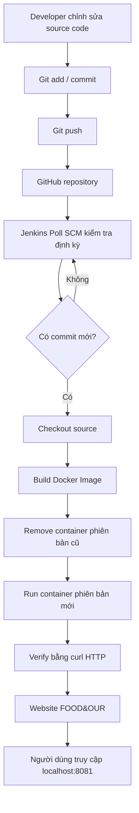

# CONFIGURE AND DEPLOY DEVOPS SERVICES IN LINUX
## Tài liệu dự án và hướng dẫn triển khai CI/CD website FOOD&OUR

> Tài liệu này mô tả quy trình xây dựng môi trường DevOps, đóng gói website bằng Docker, phục vụ website bằng Nginx và tự động build/deploy bằng Jenkins.
>
> Repository: https://github.com/ManchesterUnited-22/devops_configure  
> Jenkins job: `food-our-cicd`  
> Website sau triển khai: `http://localhost:8081/`  
> Jenkins: `http://localhost:8080/`

---

# 1. Giới thiệu dự án

## 1.1. Tên đề tài

**Configure and Deploy DevOps Services in Linux**

## 1.2. Mục tiêu

Mục tiêu của dự án là thiết lập và sử dụng các dịch vụ DevOps trên môi trường Linux để triển khai một website có sẵn. Trọng tâm không phải phát triển một website mới, mà là xây dựng quy trình quản lý mã nguồn, đóng gói, triển khai và kiểm tra ứng dụng.

Sau khi hoàn thành, quy trình hoạt động như sau:

1. Lập trình viên chỉnh sửa mã nguồn website.
2. Lập trình viên commit và push thay đổi lên GitHub.
3. Jenkins định kỳ kiểm tra repository thông qua Poll SCM.
4. Khi phát hiện commit mới, Jenkins tự khởi chạy Pipeline.
5. Jenkins lấy mã nguồn mới nhất từ GitHub.
6. Jenkins build Docker image.
7. Jenkins thay thế container đang chạy bằng container mới.
8. Jenkins kiểm tra website thông qua HTTP request.
9. Người dùng truy cập website tại `http://localhost:8081/`.

## 1.3. Phạm vi

Dự án sử dụng website FOOD&OUR đã có sẵn. Website được đóng gói và triển khai dưới dạng nội dung tĩnh bằng Nginx.

Các chức năng phụ thuộc backend PHP hoặc cơ sở dữ liệu (nếu có trong source ban đầu) không nằm trong phạm vi triển khai hiện tại. Vì vậy, những chức năng cần xử lý dữ liệu phía server như đăng nhập, giỏ hàng hoặc đặt hàng có thể không hoạt động đầy đủ. Phạm vi demo tập trung vào việc phục vụ giao diện HTML, CSS, JavaScript và hình ảnh.

---

# 2. Kiến trúc tổng thể

## 2.1. Các thành phần

| Thành phần | Vai trò |
|---|---|
| Ubuntu 24.04 trên WSL2 | Môi trường Linux để thao tác và chạy Jenkins |
| Git | Quản lý phiên bản mã nguồn |
| GitHub | Lưu trữ repository từ xa |
| Java 21 | Môi trường chạy Jenkins |
| Jenkins LTS | Điều phối quy trình CI/CD |
| Docker Desktop + WSL2 integration | Cung cấp Docker Engine để build image và chạy container |
| Dockerfile | Mô tả cách đóng gói website thành image |
| Nginx | Web server phục vụ nội dung tĩnh |
| Jenkinsfile | Khai báo các stage trong Jenkins Pipeline |

## 2.2. Sơ đồ quy trình



## 2.3. Luồng triển khai

- GitHub là nơi lưu mã nguồn trung tâm.
- Jenkins lấy source từ nhánh `main`.
- Docker image được build từ Dockerfile trong repository.
- Container chính có tên `food-our-container`.
- Website được ánh xạ cổng máy host `8081` vào cổng `80` bên trong container.
- Nginx tiếp nhận HTTP request và trả về file website.

---

# 3. Chuẩn bị môi trường

## 3.1. Môi trường sử dụng

Trong quá trình triển khai dự án, môi trường được sử dụng:

- Windows 11.
- Ubuntu 24.04 chạy trên WSL2.
- Java 21.
- Jenkins LTS 2.580.2.
- Docker Desktop có bật WSL Integration.
- Git và GitHub.

> Lưu ý: Có thể triển khai trên Ubuntu cài trực tiếp hoặc máy ảo VirtualBox. Tuy nhiên, các lệnh và đường dẫn trong tài liệu này được viết theo môi trường Ubuntu WSL2. Nếu sử dụng VirtualBox, cần điều chỉnh địa chỉ truy cập và cấu hình mạng tương ứng.

## 3.2. Cập nhật Ubuntu

```bash
sudo apt update
sudo apt upgrade -y
```

## 3.3. Cài Java 21

Kiểm tra Java:

```bash
java --version
```

Nếu chưa có Java 21:

```bash
sudo apt install openjdk-21-jdk -y
```

Kiểm tra lại:

```bash
java --version
```

Jenkins cần Java để khởi chạy. Trong dự án này, Java 21 được sử dụng làm runtime cho Jenkins.

## 3.4. Cài Jenkins LTS

Jenkins được cài từ repository Debian chính thức của Jenkins. Các lệnh cài đặt có thể thay đổi theo phiên bản Jenkins và hướng dẫn chính thức tại thời điểm cài đặt.

Kiểm tra dịch vụ:

```bash
sudo systemctl status jenkins
```

Nếu cần khởi động:

```bash
sudo systemctl start jenkins
```

Cho Jenkins tự khởi động cùng hệ thống:

```bash
sudo systemctl enable jenkins
```

Truy cập Jenkins:

```text
http://localhost:8080
```

Nếu Jenkins yêu cầu initial administrator password:

```bash
sudo cat /var/lib/jenkins/secrets/initialAdminPassword
```

Sao chép mật khẩu hiển thị vào trang Jenkins và hoàn thành các bước cài đặt ban đầu.

> Không đưa mật khẩu Jenkins, token GitHub, private key hoặc thông tin xác thực vào README hay repository công khai.

## 3.5. Cài Git

```bash
sudo apt install git -y
git --version
```

Thiết lập danh tính Git:

```bash
git config --global user.name "Your Name"
git config --global user.email "your-email@example.com"
```

Thay tên và email bằng thông tin GitHub của thành viên thực hiện commit.

## 3.6. Cài Docker Desktop và tích hợp WSL2

Trong dự án, Docker Engine được cung cấp bởi Docker Desktop trên Windows.

Các bước tổng quát:

1. Cài Docker Desktop trên Windows.
2. Mở Docker Desktop.
3. Vào Settings.
4. Bật WSL 2 based engine nếu tùy chọn này có trên phiên bản đang dùng.
5. Vào Resources → WSL Integration.
6. Bật tích hợp cho Ubuntu đang sử dụng.
7. Apply/Restart nếu được yêu cầu.
8. Mở lại terminal Ubuntu.

Kiểm tra Docker:

```bash
docker --version
docker info
```

Kiểm tra khả năng chạy container:

```bash
docker run --rm hello-world
```

Nếu Ubuntu báo không tìm thấy lệnh `docker`, hãy kiểm tra WSL Integration trong Docker Desktop và mở lại terminal.

## 3.7. Cho Jenkins quyền sử dụng Docker

Trong môi trường triển khai đã cấu hình, Jenkins cần có quyền gọi lệnh Docker.

Kiểm tra group Docker:

```bash
getent group docker
```

Thêm tài khoản Jenkins vào group Docker:

```bash
sudo usermod -aG docker jenkins
```

Khởi động lại Jenkins:

```bash
sudo systemctl restart jenkins
```

Kiểm tra Jenkins có thể gọi Docker bằng một Jenkins job kiểm tra môi trường hoặc bằng Pipeline thử nghiệm.

> Lưu ý bảo mật: Thành viên thuộc group `docker` có quyền rất cao trên Docker host, trong nhiều cấu hình tương đương quyền root. Chỉ cấp quyền cho tài khoản đáng tin cậy và không áp dụng tùy tiện trên máy chủ production.

---

# 4. Đưa source code lên GitHub

## 4.1. Clone repository

```bash
git clone https://github.com/ManchesterUnited-22/devops_configure.git
cd devops_configure
```

Nếu repository đã có trên máy:

```bash
cd ~/devops_configure
git status
```

## 4.2. Cấu trúc source liên quan

Cấu trúc dự án có các thư mục và file chính như sau:

```text
devops_configure/
├── HTML/
│   ├── Home.html
│   ├── Food.html
│   └── ...
├── Source/
│   ├── Header.css
│   ├── Footer.css
│   ├── Food.css
│   ├── Food.js
│   └── ...
├── Img/
│   └── ...
├── Img1/
│   └── ...
├── nginx/
│   └── default.conf
├── Dockerfile
├── .dockerignore
├── Jenkinsfile
└── README.md
```

Cấu trúc thực tế có thể có thêm các thư mục hoặc file khác. Điều quan trọng là Docker build context phải chứa các tài nguyên mà website tham chiếu.

## 4.3. Kiểm tra đường dẫn hình ảnh

Trong quá trình kiểm thử, website đã có một số thẻ `` tham chiếu đến tên file không tồn tại hoặc sai chữ hoa/chữ thường, sai phần mở rộng.

Để kiểm tra các ảnh nội bộ trong các file HTML thuộc thư mục `HTML/`, chạy tại thư mục gốc repository:

```bash
python3 - <<'PY'
import re
from pathlib import Path

missing = []

for html in Path("HTML").glob("*.html"):
    content = html.read_text(encoding="utf-8", errors="ignore")

    for src in re.findall(r']+src=["\']([^"\']+)["\']', content, re.I):
        if src.startswith(("http://", "https://", "data:")):
            continue

        if src.startswith("/"):
            path = Path(".") / src.lstrip("/")
        else:
            path = html.parent / src

        if not path.is_file():
            missing.append((html, src))

print("SỐ ẢNH NỘI BỘ BỊ THIẾU:", len(missing))

for html, src in missing:
    print(f"[MISSING] {html} -> {src}")
PY
```

Kết quả mong đợi sau khi sửa:

```text
SỐ ẢNH NỘI BỘ BỊ THIẾU: 0
```

Nếu có ảnh bị thiếu, kiểm tra tên file thật trong `Img/` hoặc `Img1/`, sau đó sửa `src` trong HTML cho khớp. Trên Linux, tên file có phân biệt chữ hoa/chữ thường.

## 4.4. Commit và push source

```bash
git status
git add .
git commit -m "Prepare website for Docker deployment"
git push origin main
```

Các lần cập nhật sau:

```bash
git add .
git commit -m "Describe the change"
git push origin main
```

---

# 5. Đóng gói website bằng Docker

## 5.1. Vì sao sử dụng Docker?

Docker cho phép đóng gói website cùng môi trường chạy cần thiết thành image. Nhờ đó, website có thể chạy nhất quán trong container mà không cần cài Nginx trực tiếp vào hệ điều hành host.

Trong dự án:

- Image: `food-our-web`
- Container chính: `food-our-container`
- Cổng host: `8081`
- Cổng container: `80`

## 5.2. Tạo Dockerfile

Tại thư mục gốc repository, tạo file `Dockerfile`:

```dockerfile
FROM nginx:alpine

COPY . /usr/share/nginx/html/

COPY nginx/default.conf /etc/nginx/conf.d/default.conf

EXPOSE 80
```

Giải thích:

| Chỉ thị | Ý nghĩa |
|---|---|
| `FROM nginx:alpine` | Dùng image Nginx phiên bản Alpine làm image nền |
| `COPY . /usr/share/nginx/html/` | Sao chép source website vào thư mục phục vụ nội dung của Nginx |
| `COPY nginx/default.conf ...` | Thay cấu hình server mặc định bằng cấu hình của dự án |
| `EXPOSE 80` | Khai báo cổng mà Nginx sử dụng bên trong container |

`EXPOSE 80` là thông tin mô tả cổng; việc publish cổng ra host được thực hiện bằng tùy chọn `-p` khi chạy `docker run`.

## 5.3. Tạo `.dockerignore`

File `.dockerignore` giúp loại bỏ những nội dung không cần thiết khỏi Docker build context.

Nội dung:

```text
.git
.gitignore
README.md
```

Nếu dự án có file/thư mục không cần đưa vào image, có thể bổ sung sau khi xác định chắc chắn website không sử dụng chúng.

## 5.4. Cấu hình Nginx

Tạo thư mục và file:

```bash
mkdir -p nginx
nano nginx/default.conf
```

Nội dung cấu hình:

```nginx
server {
    listen 80;
    server_name localhost;

    root /usr/share/nginx/html;
    index HTML/Home.html;

    location / {
        try_files $uri $uri/ /HTML/$uri /HTML/Home.html;
    }
}
```

Giải thích:

- `listen 80`: Nginx lắng nghe cổng 80 trong container.
- `server_name localhost`: tên server cho cấu hình này.
- `root /usr/share/nginx/html`: thư mục gốc chứa source đã được Docker COPY vào.
- `index HTML/Home.html`: trang mặc định là `HTML/Home.html`.
- `location /`: xử lý request bắt đầu từ đường dẫn gốc.
- `try_files`: thử tìm file/thư mục tương ứng; nếu không tìm thấy thì thử đường dẫn trong `HTML/`, cuối cùng fallback về trang chủ.

Cấu hình này phù hợp với cấu trúc dự án có file HTML nằm trong thư mục `HTML/`, trong khi `Img/`, `Img1/` và `Source/` nằm ở thư mục gốc.

## 5.5. Build Docker image thủ công để kiểm tra

Từ thư mục gốc repository:

```bash
docker build -t food-our-web:test .
```

Kiểm tra image:

```bash
docker images
```

Chạy container kiểm thử:

```bash
docker rm -f food-our-test 2>/dev/null || true

docker run -d \
  --name food-our-test \
  -p 8082:80 \
  food-our-web:test
```

Kiểm tra:

```bash
docker ps
```

Mở trình duyệt:

```text
http://localhost:8082/
```

Kiểm tra trang chủ, trang Food, CSS, JavaScript và hình ảnh. Khi đã xác nhận bản test hoạt động, có thể dọn container test:

```bash
docker rm -f food-our-test
```

---

# 6. Xây dựng Jenkins Pipeline

## 6.1. Jenkins Pipeline là gì?

Jenkins Pipeline là quy trình tự động hóa được khai báo dưới dạng mã. Trong dự án, Pipeline được lưu trong file `Jenkinsfile` tại thư mục gốc repository.

Pipeline gồm bốn stage:

1. Checkout.
2. Build Docker Image.
3. Deploy Container.
4. Verify Deployment.

## 6.2. Nội dung Jenkinsfile

File `Jenkinsfile`:

```groovy
pipeline {
    agent any

    options {
        timestamps()
    }

    environment {
        IMAGE_NAME = 'food-our-web'
        CONTAINER_NAME = 'food-our-container'
        HOST_PORT = '8081'
    }

    stages {
        stage('Checkout') {
            steps {
                echo 'Getting source code from GitHub...'
                checkout scm
            }
        }

        stage('Build Docker Image') {
            steps {
                echo 'Building Docker image...'
                sh '''
                    docker build -t ${IMAGE_NAME}:${BUILD_NUMBER} .
                    docker tag ${IMAGE_NAME}:${BUILD_NUMBER} ${IMAGE_NAME}:latest
                '''
            }
        }

        stage('Deploy Container') {
            steps {
                echo 'Deploying website...'
                sh '''
                    docker rm -f ${CONTAINER_NAME} || true

                    docker run -d \
                        --name ${CONTAINER_NAME} \
                        --restart unless-stopped \
                        -p ${HOST_PORT}:80 \
                        ${IMAGE_NAME}:${BUILD_NUMBER}
                '''
            }
        }

        stage('Verify Deployment') {
            steps {
                echo 'Checking website availability...'
                sh '''
                    curl --retry 5 \
                         --retry-connrefused \
                         --retry-delay 2 \
                         -f http://localhost:${HOST_PORT}/
                '''
            }
        }
    }

    post {
        success {
            echo 'Deployment completed successfully!'
        }

        failure {
            echo 'Pipeline failed. Please check the console output.'
        }
    }
}
```

## 6.3. Giải thích Jenkinsfile

### Khai báo Pipeline

```groovy
pipeline {
    agent any
```

`pipeline` khai báo một Declarative Pipeline. `agent any` cho phép Jenkins chọn agent phù hợp để chạy Pipeline. Trong cấu hình hiện tại, job chạy trên Jenkins node đang có quyền truy cập Docker.

### Timestamps

```groovy
options {
    timestamps()
}
```

Hiển thị thời gian ở các dòng log để dễ theo dõi quá trình thực thi.

### Biến môi trường

```groovy
environment {
    IMAGE_NAME = 'food-our-web'
    CONTAINER_NAME = 'food-our-container'
    HOST_PORT = '8081'
}
```

- `IMAGE_NAME`: tên image.
- `CONTAINER_NAME`: tên container triển khai chính.
- `HOST_PORT`: cổng host dùng để truy cập website.

### Stage 1: Checkout

```groovy
stage('Checkout') {
    steps {
        echo 'Getting source code from GitHub...'
        checkout scm
    }
}
```

Lấy source code từ repository và branch đã khai báo trong cấu hình job Jenkins. `checkout scm` sử dụng cấu hình SCM của chính job.

### Stage 2: Build Docker Image

```groovy
docker build -t ${IMAGE_NAME}:${BUILD_NUMBER} .
docker tag ${IMAGE_NAME}:${BUILD_NUMBER} ${IMAGE_NAME}:latest
```

- Build image từ Dockerfile ở thư mục hiện tại.
- `BUILD_NUMBER` là số thứ tự build do Jenkins cấp.
- Tag `latest` trỏ đến image vừa build.

Ví dụ, ở build số 2, image có tag `food-our-web:2`.

### Stage 3: Deploy Container

```groovy
docker rm -f ${CONTAINER_NAME} || true
```

Xóa container cũ nếu tồn tại. `|| true` giúp lệnh không làm Pipeline thất bại khi chưa có container cũ.

```groovy
docker run -d \
    --name ${CONTAINER_NAME} \
    --restart unless-stopped \
    -p ${HOST_PORT}:80 \
    ${IMAGE_NAME}:${BUILD_NUMBER}
```

- `-d`: chạy container nền.
- `--name`: đặt tên container.
- `--restart unless-stopped`: tự khởi động lại container khi phù hợp, trừ khi bị người quản trị chủ động dừng.
- `-p 8081:80`: ánh xạ cổng 8081 trên host vào cổng 80 trong container.
- Dùng image gắn với số build hiện tại.

### Stage 4: Verify Deployment

```groovy
curl --retry 5 \
     --retry-connrefused \
     --retry-delay 2 \
     -f http://localhost:${HOST_PORT}/
```

Gửi HTTP request đến website vừa triển khai.

- `--retry 5`: thử lại tối đa 5 lần khi có lỗi phù hợp.
- `--retry-connrefused`: thử lại nếu kết nối bị từ chối.
- `--retry-delay 2`: chờ 2 giây giữa các lần thử.
- `-f`: trả về lỗi nếu server phản hồi HTTP status lỗi.

Nếu request thành công, stage Verify Deployment thành công.

> Kiểm tra HTTP bằng `curl -f` xác nhận endpoint phản hồi thành công ở mức HTTP. Nó không thay thế kiểm thử giao diện trình duyệt hoặc kiểm thử từng chức năng ứng dụng.

### Post actions

- `success`: ghi log khi Pipeline thành công.
- `failure`: ghi thông báo khi Pipeline thất bại.

## 6.4. Tạo Pipeline job trong Jenkins

Truy cập:

```text
http://localhost:8080
```

Thực hiện:

1. Chọn **New Item**.
2. Đặt tên `food-our-cicd`.
3. Chọn loại **Pipeline**.
4. Nhấn OK.
5. Trong cấu hình job, tìm mục Pipeline.
6. Chọn **Pipeline script from SCM**.
7. SCM: chọn **Git**.
8. Repository URL:

   ```text
   https://github.com/ManchesterUnited-22/devops_configure.git
   ```

9. Branch Specifier:

   ```text
   */main
   ```

10. Script Path:

    ```text
    Jenkinsfile
    ```

11. Lưu cấu hình.

Nếu repository là private, cần cấu hình Credentials phù hợp trong Jenkins. Không ghi token hoặc mật khẩu trực tiếp trong Jenkinsfile.

## 6.5. Chạy Pipeline lần đầu

Trong job `food-our-cicd`:

1. Chọn **Build Now**.
2. Mở build mới nhất.
3. Chọn **Console Output** để xem log.
4. Kiểm tra đủ bốn stage và trạng thái thành công.

Kết quả mong muốn:

| Stage | Kết quả |
|---|---|
| Checkout | Thành công |
| Build Docker Image | Thành công |
| Deploy Container | Thành công |
| Verify Deployment | Thành công |

---

# 7. Cấu hình tự động phát hiện thay đổi bằng Poll SCM

## 7.1. Poll SCM là gì?

Poll SCM là cơ chế để Jenkins định kỳ kiểm tra repository SCM. Nếu Jenkins phát hiện thay đổi mới trong repository, job có thể được kích hoạt để chạy Pipeline.

Trong dự án, Poll SCM được sử dụng thay cho GitHub webhook. Cấu hình này phù hợp với môi trường Jenkins chạy cục bộ trên WSL2, không cần công khai Jenkins server ra Internet.

## 7.2. Cấu hình Poll SCM

Trong Jenkins:

1. Mở job `food-our-cicd`.
2. Chọn **Configure**.
3. Tìm phần **Build Triggers**.
4. Tích **Poll SCM**.
5. Nhập lịch:

   ```text
   H/2 * * * *
   ```

6. Nhấn **Save**.

Lịch trên yêu cầu Jenkins kiểm tra repository khoảng mỗi hai phút, theo cơ chế phân tán phút của cú pháp Jenkins cron.

Không cần tích `GitHub hook trigger for GITScm polling` nếu chỉ sử dụng Poll SCM.

## 7.3. Kiểm thử tự động

Thực hiện một thay đổi nhỏ, dễ nhận biết trong `HTML/Home.html`. Ví dụ thay nội dung một đoạn giới thiệu bằng một chuỗi đánh dấu thử nghiệm.

Kiểm tra thay đổi:

```bash
git diff
```

Commit và push:

```bash
git add HTML/Home.html
git commit -m "Test automatic CI/CD deployment"
git push origin main
```

Sau khi push:

1. Không nhấn **Build Now**.
2. Mở job `food-our-cicd`.
3. Chờ chu kỳ Poll SCM tiếp theo.
4. Quan sát Build History.
5. Nếu có commit mới được phát hiện, Jenkins tự tạo build mới.
6. Mở Console Output và kiểm tra các stage.

Sau khi Pipeline thành công, mở:

```text
http://localhost:8081/
```

Xác nhận nội dung thử nghiệm đã xuất hiện. Đây là minh chứng cho luồng cập nhật tự động từ GitHub qua Jenkins đến website.

> Poll SCM không phải webhook tức thời. Jenkins kiểm tra theo lịch, do đó có thể có độ trễ giữa thời điểm push và thời điểm Pipeline bắt đầu.

---

# 8. Kiểm tra trạng thái triển khai

## 8.1. Kiểm tra container

```bash
docker ps
```

Container chính cần có tên:

```text
food-our-container
```

Port mapping mong đợi:

```text
0.0.0.0:8081->80/tcp
```

Image có tag theo số build, ví dụ:

```text
food-our-web:2
```

Số build thực tế có thể thay đổi theo lịch sử Jenkins.

## 8.2. Kiểm tra website

Mở trình duyệt:

```text
http://localhost:8081/
```

Kiểm tra:

- Trang chủ hiển thị.
- CSS được tải.
- JavaScript được tải.
- Hình ảnh nội bộ hiển thị.
- Trang Food có thể truy cập.
- Nội dung vừa cập nhật được hiển thị sau khi Pipeline deploy thành công.

## 8.3. Kiểm tra HTTP bằng curl

```bash
curl -I http://localhost:8081/
```

Có thể kiểm tra một số tài nguyên cụ thể:

```bash
curl -I http://localhost:8081/Img/Laubo.webp
```

Đường dẫn ảnh cần kiểm tra phải là file thực tế đang có trong repository.

## 8.4. Xem log container

```bash
docker logs food-our-container
```

Theo dõi log trực tiếp:

```bash
docker logs -f food-our-container
```

Nhấn `Ctrl+C` để thoát chế độ theo dõi log.

---

# 9. Các lỗi đã gặp và cách xử lý

## 9.1. Ubuntu không nhận lệnh Docker

Triệu chứng:

```text
The command 'docker' could not be found in this WSL 2 distro.
```

Nguyên nhân thường gặp: Docker Desktop chưa bật WSL Integration cho distro Ubuntu đang sử dụng.

Cách xử lý:

1. Mở Docker Desktop.
2. Vào Settings → Resources → WSL Integration.
3. Bật Ubuntu.
4. Apply/Restart.
5. Mở lại terminal Ubuntu.
6. Kiểm tra:

   ```bash
   docker --version
   docker info
   ```

## 9.2. Jenkins không có quyền chạy Docker

Triệu chứng: Pipeline chạy `docker build` hoặc `docker run` nhưng nhận lỗi permission.

Kiểm tra và xử lý theo cấu hình group:

```bash
sudo usermod -aG docker jenkins
sudo systemctl restart jenkins
```

Sau đó chạy lại job kiểm tra môi trường và Pipeline.

## 9.3. Website không tìm thấy trang chủ

Nguyên nhân: file trang chủ nằm trong thư mục `HTML/`, không nằm trực tiếp ở thư mục root mặc định của Nginx.

Cách xử lý: cấu hình Nginx sử dụng:

```nginx
index HTML/Home.html;
```

và quy tắc `try_files` phù hợp với cấu trúc thư mục.

## 9.4. Hình ảnh không hiển thị

Nguyên nhân có thể:

- Tên file trong HTML không trùng với file thực tế.
- Sai phần mở rộng `.jpg`, `.jpeg`, `.png`, `.webp`.
- Sai chữ hoa/chữ thường.
- Đường dẫn tương đối không phù hợp.

Cách xử lý:

1. Liệt kê file thực tế trong `Img/` và `Img1/`.
2. Kiểm tra các thuộc tính `src` trong HTML.
3. Sửa đường dẫn để khớp file thật.
4. Chạy script kiểm tra ảnh nội bộ.
5. Build image mới và tạo lại container test.
6. Kiểm tra lại website trên trình duyệt.

## 9.5. Cổng 8081 đã được sử dụng

Kiểm tra container:

```bash
docker ps
```

Nếu container cũ đang giữ cổng, kiểm tra trước khi dừng hoặc xóa. Pipeline hiện tại chủ động xóa container có tên `food-our-container` trước khi tạo container mới.

Không xóa container khác nếu chưa xác định được mục đích của nó.

## 9.6. Poll SCM chưa kích hoạt build

Kiểm tra:

1. Poll SCM đã được tích trong Build Triggers chưa.
2. Schedule có đúng `H/2 * * * *` không.
3. Job có cấu hình đúng repository và branch `*/main` không.
4. Commit mới đã push lên đúng branch chưa.
5. Jenkins có truy cập được repository không.
6. Xem log polling trong trang job nếu Jenkins hiển thị thông tin polling.

Chờ hết chu kỳ kiểm tra trước khi kết luận Poll SCM không hoạt động.

---

# 10. Quy trình triển khai lại dành cho thành viên nhóm

Phần này tóm tắt các bước một thành viên khác cần thực hiện để triển khai lại dự án trên máy của mình.

## Bước 1. Chuẩn bị

- Cài Ubuntu hoặc Ubuntu trên WSL2.
- Cài Java 21.
- Cài Jenkins LTS.
- Cài Docker Desktop và bật WSL Integration nếu sử dụng WSL2.
- Cài Git.

## Bước 2. Lấy source

```bash
git clone https://github.com/ManchesterUnited-22/devops_configure.git
cd devops_configure
```

## Bước 3. Kiểm tra source và cấu hình

- Kiểm tra `Dockerfile`.
- Kiểm tra `.dockerignore`.
- Kiểm tra `nginx/default.conf`.
- Kiểm tra `Jenkinsfile`.
- Kiểm tra đường dẫn ảnh trong HTML.

## Bước 4. Kiểm thử Docker thủ công

```bash
docker build -t food-our-web:test .

docker rm -f food-our-test 2>/dev/null || true

docker run -d \
  --name food-our-test \
  -p 8082:80 \
  food-our-web:test
```

Truy cập:

```text
http://localhost:8082/
```

Nếu website hoạt động, dọn container test:

```bash
docker rm -f food-our-test
```

## Bước 5. Cấu hình quyền Docker cho Jenkins

```bash
sudo usermod -aG docker jenkins
sudo systemctl restart jenkins
```

Xác nhận Jenkins thực sự chạy được Docker trước khi triển khai Pipeline.

## Bước 6. Tạo Jenkins job

Tạo Pipeline job `food-our-cicd`, cấu hình Pipeline script from SCM, Git repository, branch `*/main`, Script Path `Jenkinsfile`.

## Bước 7. Chạy thử Pipeline

Nhấn Build Now lần đầu và kiểm tra đủ bốn stage.

## Bước 8. Cấu hình Poll SCM

Trong Build Triggers, bật Poll SCM và dùng:

```text
H/2 * * * *
```

## Bước 9. Kiểm thử cập nhật tự động

Sửa một nội dung nhỏ, commit và push lên `main`. Không nhấn Build Now. Chờ Jenkins poll repository và xác nhận build mới tự chạy.

## Bước 10. Kiểm tra kết quả

```text
http://localhost:8081/
```

```bash
docker ps
```

Xác nhận container `food-our-container` đang chạy và website hiển thị nội dung mới.

---

# 11. Kết quả đạt được

Sau quá trình thực hiện, dự án đã đạt được các kết quả kỹ thuật sau:

1. Thiết lập môi trường Linux để triển khai dịch vụ DevOps.
2. Quản lý mã nguồn website bằng Git và GitHub.
3. Đóng gói website thành Docker image.
4. Chạy website trong Docker container.
5. Sử dụng Nginx để phục vụ nội dung website.
6. Xây dựng Jenkins Pipeline gồm Checkout, Build Docker Image, Deploy Container và Verify Deployment.
7. Jenkins có thể lấy mã nguồn mới từ GitHub và triển khai website.
8. Cấu hình Poll SCM để Jenkins định kỳ phát hiện thay đổi trên repository.
9. Kiểm thử thay đổi mã nguồn, push lên GitHub và xác nhận Jenkins tự chạy Pipeline.
10. Xác nhận website sau triển khai truy cập được tại `http://localhost:8081/`.

## 11.1. Thông tin triển khai của dự án

| Thuộc tính | Giá trị |
|---|---|
| Git repository | `ManchesterUnited-22/devops_configure` |
| Branch | `main` |
| Jenkins job | `food-our-cicd` |
| Jenkins URL | `http://localhost:8080` |
| Website URL | `http://localhost:8081/` |
| Test URL | `http://localhost:8082/` |
| Docker image | `food-our-web` |
| Main container | `food-our-container` |
| Test container | `food-our-test` |
| Host port | `8081` |
| Container port | `80` |
| Poll SCM schedule | `H/2 * * * *` |

---

# 12. Lưu ý vận hành và bảo mật

- Không commit mật khẩu, token, SSH private key hoặc Jenkins credentials vào Git.
- Không mở Jenkins ra Internet nếu chưa có biện pháp bảo vệ phù hợp.
- Poll SCM phù hợp với demo và môi trường Jenkins cục bộ; webhook yêu cầu GitHub có thể truy cập endpoint Jenkins.
- Group `docker` có quyền mạnh trên máy host; cần kiểm soát tài khoản được cấp quyền.
- Pipeline hiện tại xóa container cũ trước khi tạo container mới. Đây là cách triển khai đơn giản phù hợp với demo, nhưng không phải chiến lược zero-downtime.
- Nên giữ lại log Jenkins và ảnh chụp màn hình các lần build thành công làm minh chứng.
- Nếu triển khai trên máy khác, cần kiểm tra cổng 8080, 8081, 8082 có bị dịch vụ khác sử dụng không.

---

# 13. Kết luận

Dự án đã xây dựng được một quy trình DevOps thực tế cho website FOOD&OUR trên môi trường Linux. Mã nguồn được quản lý trên GitHub, website được đóng gói bằng Docker, Nginx đảm nhiệm việc phục vụ nội dung và Jenkins điều phối quy trình CI/CD.

Với cấu hình Poll SCM, Jenkins có thể định kỳ kiểm tra repository và tự động chạy Pipeline khi phát hiện thay đổi mới. Pipeline thực hiện lần lượt việc lấy mã nguồn, build Docker image, triển khai container và kiểm tra website sau triển khai.

Quy trình này minh họa cách các công cụ DevOps phối hợp với nhau để giảm thao tác triển khai thủ công, tăng tính nhất quán và hỗ trợ cập nhật ứng dụng.

---

## Tài liệu tham khảo

- Jenkins Documentation: https://www.jenkins.io/doc/
- Jenkins Pipeline: https://www.jenkins.io/doc/book/pipeline/
- Jenkins Pipeline Syntax: https://www.jenkins.io/doc/book/pipeline/syntax/
- Jenkins Cron / Build periodically and Poll SCM: https://www.jenkins.io/doc/book/pipeline/syntax/
- Docker Documentation: https://docs.docker.com/
- Dockerfile reference: https://docs.docker.com/reference/dockerfile/
- Nginx Documentation: https://nginx.org/en/docs/
- Git Documentation: https://git-scm.com/doc/
- GitHub Docs: https://docs.github.com/

---

*Tài liệu được viết theo cấu hình và quy trình triển khai của dự án FOOD&OUR. Khi thay đổi repository, branch, tên image, container, cổng hoặc môi trường, cần cập nhật các giá trị tương ứng trong tài liệu và cấu hình triển khai.*
