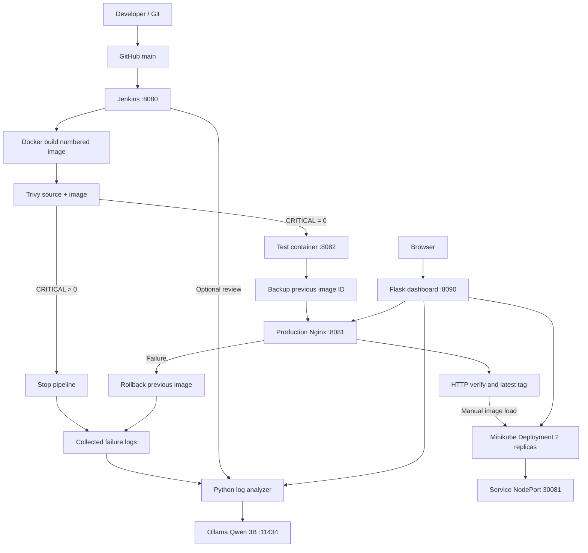

# FOOD&OUR — DevOps CI/CD, AI Operations & Security

> Đồ án Linux: tự động hóa xây dựng, kiểm thử, bảo mật, triển khai và khôi phục website FOOD&OUR; tích hợp AI chạy cục bộ hỗ trợ vận hành.

Repository: https://github.com/ManchesterUnited-22/devops_configure · Nhánh: `main` · Phiên bản mục tiêu: `v1.0.0` (chỉ tạo tag sau khi xác nhận bản cuối).

## Mục lục

- [1. Giới thiệu](#1-giới-thiệu)
- [2. Công nghệ](#2-công-nghệ)
- [3. Kiến trúc và cấu trúc mã nguồn](#3-kiến-trúc-và-cấu-trúc-mã-nguồn)
- [4. Cài đặt từ đầu](#4-cài-đặt-từ-đầu)
- [5. Luồng vận hành và phân tích code](#5-luồng-vận-hành-và-phân-tích-code)
- [6. Vận hành và hiển thị](#6-vận-hành-và-hiển-thị)
- [7. Kịch bản kiểm thử](#7-kịch-bản-kiểm-thử)
- [8. Đọc log và xử lý sự cố](#8-đọc-log-và-xử-lý-sự-cố)
- [9. Kết quả và giới hạn](#9-kết-quả-và-giới-hạn)
- [10. Chốt phiên bản](#10-chốt-phiên-bản)
- [11. Dàn slide cho ba thành viên](#11-dàn-slide-cho-ba-thành-viên)

**Phạm vi tài liệu:** cấu hình Docker, Nginx, Kubernetes, scanner và các trích đoạn Jenkins dựa trên nội dung đã trao đổi; log dựa trên kết quả Terminal đã cung cấp. Các ví dụ Python/API được ghi là minh họa khi chưa đối chiếu file cuối. Không truy cập được repository trực tiếp trong phiên soạn tài liệu này; cần đối chiếu tên biến, endpoint và mã nguồn AI trước khi coi tài liệu là bản đặc tả chính xác từng dòng. Các lệnh cài đặt là hướng dẫn tái lập, không phải nhật ký cài đặt đã thực hiện.

## 1. Giới thiệu

FOOD&OUR là website giao diện giới thiệu, lựa chọn món ăn và đồ uống. Đồ án tập trung vào **quy trình vận hành phần mềm trên Linux**, không phải xây dựng một hệ thống thương mại điện tử hoàn chỉnh. Website được Nginx phục vụ dưới dạng nội dung tĩnh. Sự tồn tại của thư mục `Php/` không chứng minh PHP hay cơ sở dữ liệu đang chạy; cấu hình hiện tại không có PHP-FPM.

Bài toán: triển khai thủ công dễ nhầm phiên bản, không kiểm tra trước khi đưa lên production, khó phát hiện cấu hình nguy hiểm và mất thời gian đọc log khi có sự cố. Giải pháp: Jenkins điều phối pipeline, Docker đóng gói, Trivy kiểm tra bảo mật, Nginx phục vụ website, Kubernetes duy trì replica, Ollama và Python hỗ trợ phân tích lỗi, Flask cung cấp dashboard nội bộ.

Mục tiêu: tự động build/test/deploy từ Git; chặn CRITICAL; rollback khi deployment thất bại; tự phục hồi Pod; phân tích log và review code bằng AI cục bộ; thu thập bằng chứng kiểm thử có thể tái lập. AI chỉ tư vấn, không tự thực thi lệnh hoặc sửa production.

## 2. Công nghệ

| Công nghệ | Là gì | Vai trò trong dự án |
|---|---|---|
| Windows + WSL2 | Môi trường Linux sử dụng kernel Linux trong Windows | Chạy Ubuntu, terminal, dịch vụ và công cụ DevOps |
| Ubuntu/Linux | Hệ điều hành, quản lý tiến trình, quyền, mạng, file | Nền tảng vận hành; systemd quản lý Jenkins/Docker |
| Bash | Shell và ngôn ngữ script | Scan, cấu hình, benchmark, chẩn đoán, các bước Jenkins |
| Git | Quản lý phiên bản phân tán | Commit, diff, tag, lịch sử, nguồn rollback mã |
| GitHub | Dịch vụ lưu Git repository | Nguồn SCM cho Jenkins; không phải máy chủ website |
| Jenkins + Java | Máy chủ tự động hóa chạy trên JVM | Checkout, build, scan, test, deploy, rollback, lưu artifact |
| Groovy/Declarative Pipeline | DSL khai báo pipeline Jenkins | `Jenkinsfile`, stages, parameters, post actions |
| Docker Engine/CLI | Runtime container và công cụ đóng gói | Build image, chạy container, log, inspect, tag |
| Dockerfile/BuildKit | Công thức build và bộ thực thi build | Tạo image Nginx chứa website; cache layer |
| Alpine Linux | Distribution nhỏ dùng trong image | Base OS của `nginx:alpine`, cập nhật bằng apk |
| Nginx | Web server HTTP | Phục vụ HTML/CSS/JS/ảnh, route fallback |
| HTML/CSS/JavaScript | Công nghệ giao diện web | Trang FOOD&OUR và dashboard; không cần build Node.js theo cấu hình hiện tại |
| Kubernetes | Điều phối container theo trạng thái mong muốn | Deployment, replica, rolling update, self-healing, Service |
| Minikube | Kubernetes cục bộ | Cluster thực hành một node với Docker driver |
| kubectl | CLI giao tiếp Kubernetes API | Apply, get, exec, logs, rollout |
| YAML | Định dạng khai báo dữ liệu | Manifest Deployment và Service |
| Trivy | Scanner lỗ hổng, secret, misconfiguration | Quét source/image; tạo JSON; gate CRITICAL |
| Python 3 | Ngôn ngữ lập trình | AI client, phân tích log, review, tổng hợp scan |
| venv/pip | Môi trường và quản lý thư viện Python | Cô lập dependencies giữa máy cá nhân và Jenkins |
| Flask | Web framework Python | Dashboard và API nội bộ |
| requests | HTTP client Python | Gọi Ollama và kiểm tra HTTP |
| python-dotenv | Đọc biến môi trường từ `.env` | Cấu hình model/URL; không commit bí mật |
| Ollama | Runtime chạy mô hình ngôn ngữ cục bộ | API inference tại cổng 11434 |
| Qwen2.5-Coder:3b | Mô hình ngôn ngữ chuyên code khoảng 3 tỷ tham số | Review thay đổi và giải thích log bằng tiếng tự nhiên |
| HTTP/REST/JSON | Giao thức và định dạng trao đổi dữ liệu | Dashboard gọi backend, backend gọi Ollama, scanner xuất báo cáo |
| curl/wget | HTTP client dòng lệnh | Kiểm tra endpoint và healthcheck |
| systemctl, ss, free, df, uptime, lscpu | Công cụ quản trị Linux | Kiểm tra dịch vụ, port, RAM, disk, tải và CPU |

**Phân biệt:** Docker image là mẫu đóng gói; container là instance chạy. Kubernetes Pod bao bọc container; Deployment duy trì số Pod; Service tạo endpoint ổn định. Jenkins điều phối chứ không thay thế Docker. Ollama chạy model; Flask chỉ là giao diện/API, không phải mô hình AI. WSL2, GitHub, Jenkins và Docker có vai trò khác nhau, không phải tất cả đều là framework.

## 3. Kiến trúc và cấu trúc mã nguồn



Jenkins chạy Docker production độc lập với Minikube. Mũi tên đồng bộ Kubernetes là **thao tác thủ công**, không phải một stage tự động hiện có.

```text
devops_configure/
├── HTML/ Img/ Img1/ Php/ Source/    # Website
├── Dockerfile                      # Build Nginx image
├── Jenkinsfile                     # Pipeline
├── nginx/default.conf              # Server block
├── nginx/nginx.conf                # Main config non-root
├── k8s/deployment.yaml             # Deployment + Service
├── ai/
│   ├── __init__.py
│   ├── engine.py                   # Ollama client
│   ├── code_review.py              # Review Git changes
│   └── log_analyzer.py              # Lọc và phân tích log
├── dashboard/
│   ├── app.py
│   ├── templates/index.html
│   └── static/                     # CSS/JS
├── security/scan.sh
├── scripts/
│   ├── configure.sh
│   ├── setup_ai.sh
│   ├── start_ai.sh
│   ├── diagnose.sh
│   └── benchmark.sh
├── reports/.gitkeep
├── requirements.txt
├── .env.example
├── .gitignore
├── .dockerignore
└── README.md
```

| Endpoint | Công dụng |
|---|---|
| http://localhost:8080 | Jenkins |
| http://localhost:8081 | Production Docker |
| http://localhost:8082 | Test container, chỉ tồn tại khi test |
| http://localhost:8090 | DevOps AI Center |
| http://127.0.0.1:11434/api/tags | Ollama model list |
| NodePort 30081 | Kubernetes Service; dùng `minikube service food-our --url` để truy cập |

## 4. Cài đặt từ đầu

### 4.1. WSL2 và Ubuntu

PowerShell (Windows, quyền Administrator nếu cần):

```powershell
wsl --install -d Ubuntu
wsl --update
wsl -l -v
```

Khởi động lại nếu Windows yêu cầu. Trong Ubuntu:

```bash
cat /etc/os-release
uname -a
ps -p 1 -o comm=
sudo apt update
sudo apt install -y git curl wget ca-certificates gnupg python3 python3-pip python3-venv
```

Nếu PID 1 chưa là systemd, thêm `[boot]` và `systemd=true` vào `/etc/wsl.conf` (giữ các cấu hình cũ), rồi chạy `wsl --shutdown` từ PowerShell và mở Ubuntu lại. Không chạy các lệnh cài mới đè lên môi trường đang hoạt động nếu chỉ demo.

### 4.2. Git và repository

```bash
git --version
git clone https://github.com/ManchesterUnited-22/devops_configure.git
cd devops_configure
git status
git log -1 --oneline
```

Nếu thư mục đã tồn tại, dùng `cd ~/devops_configure`; không clone chồng. Cấu hình `git config --global user.name` và `user.email` bằng thông tin của thành viên. Push qua SSH hoặc credential helper/token phù hợp; không ghi token vào README hoặc URL.

### 4.3. Docker Engine

Chọn Docker Engine trong Ubuntu như môi trường đồ án, hoặc Docker Desktop WSL integration nếu đã dùng; không cài hai daemon chồng chéo. Ví dụ cài Engine từ kho chính thức Ubuntu:

```bash
sudo install -m 0755 -d /etc/apt/keyrings
sudo curl -fsSL https://download.docker.com/linux/ubuntu/gpg -o /etc/apt/keyrings/docker.asc
sudo chmod a+r /etc/apt/keyrings/docker.asc
. /etc/os-release
echo "deb [arch=$(dpkg --print-architecture) signed-by=/etc/apt/keyrings/docker.asc] https://download.docker.com/linux/ubuntu ${UBUNTU_CODENAME:-$VERSION_CODENAME} stable" | sudo tee /etc/apt/sources.list.d/docker.list
sudo apt update
sudo apt install -y docker-ce docker-ce-cli containerd.io docker-buildx-plugin docker-compose-plugin
sudo systemctl enable --now docker
sudo usermod -aG docker "$USER"
```

Đăng xuất/mở lại phiên Linux để nhận group, sau đó `docker version`, `docker run --rm hello-world`. Group `docker` có quyền tương đương root; chỉ cấp cho tài khoản tin cậy.

### 4.4. Jenkins

Cài Java tương thích với phiên bản Jenkins LTS, ví dụ Java 21 trên Ubuntu hỗ trợ:

```bash
sudo apt install -y fontconfig openjdk-21-jre
java -version
```

Thêm kho Jenkins LTS và signing key theo hướng dẫn hiện hành tại https://www.jenkins.io/doc/book/installing/linux/ (key có thể thay đổi theo năm), rồi:

```bash
sudo apt update
sudo apt install -y jenkins
sudo systemctl enable --now jenkins
sudo cat /var/lib/jenkins/secrets/initialAdminPassword
```

Mở `http://localhost:8080`, nhập mật khẩu khởi tạo, cài suggested plugins (Pipeline, Git, Credentials, Script Security, Timestamper nếu thiếu), tạo admin. Không đưa mật khẩu lên slide. Tạo New Item → Pipeline → Pipeline script from SCM → Git → URL repository → branch `*/main` → Script Path `Jenkinsfile`. Có thể cấu hình Poll SCM như `H/5 * * * *` nếu muốn Jenkins kiểm tra thay đổi định kỳ; không mặc định webhook GitHub truy cập được localhost. Tên job thực tế trong log: `food-our-cicd`.

```bash
sudo usermod -aG docker jenkins
sudo systemctl restart jenkins
sudo -u jenkins docker ps
sudo -u jenkins python3 --version
```

Jenkins chạy bằng user `jenkins`, workspace riêng `/var/lib/jenkins/workspace/food-our-cicd`, không dùng venv của user `lap`. Không tắt Groovy sandbox để đọc raw build.

### 4.5. Trivy

Cài từ kho chính thức Aqua (tham khảo https://trivy.dev/latest/getting-started/installation/):

```bash
curl -fsSL https://aquasecurity.github.io/trivy-repo/deb/public.key | sudo gpg --dearmor -o /usr/share/keyrings/trivy.gpg
echo 'deb [signed-by=/usr/share/keyrings/trivy.gpg] https://aquasecurity.github.io/trivy-repo/deb generic main' | sudo tee /etc/apt/sources.list.d/trivy.list
sudo apt update
sudo apt install -y trivy
trivy --version
sudo -u jenkins trivy --version
```

Lần đầu cần mạng tải vulnerability DB và checks; cache giúp các lần sau nhanh hơn. Phiên bản quan sát trong Jenkins: 0.76.2.

### 4.6. kubectl và Minikube

Ví dụ Ubuntu x86_64 (máy đồ án):

```bash
KVER=$(curl -fsSL https://dl.k8s.io/release/stable.txt)
curl -fLO "https://dl.k8s.io/release/$KVER/bin/linux/amd64/kubectl"
curl -fLO "https://dl.k8s.io/release/$KVER/bin/linux/amd64/kubectl.sha256"
echo "$(cat kubectl.sha256)  kubectl" | sha256sum --check
sudo install -m 0755 kubectl /usr/local/bin/kubectl
curl -fLo minikube https://storage.googleapis.com/minikube/releases/latest/minikube-linux-amd64
# Đối chiếu checksum chính thức của release trước khi cài.
sudo install -m 0755 minikube /usr/local/bin/minikube
minikube start --driver=docker
kubectl config use-context minikube
kubectl get nodes
```

Chọn phiên bản kubectl tương thích API server (thông thường chênh tối đa một minor); hướng dẫn chính thức: https://kubernetes.io/docs/tasks/tools/ và https://minikube.sigs.k8s.io/docs/start/. Không dùng `sudo minikube` với Docker driver thông thường.

### 4.7. Ollama và Python

Tải installer chính thức, kiểm tra nội dung trước khi chạy:

```bash
curl -fsSL https://ollama.com/install.sh -o /tmp/ollama-install.sh
less /tmp/ollama-install.sh
sh /tmp/ollama-install.sh
ollama pull qwen2.5-coder:3b
ollama list
curl -fsS http://127.0.0.1:11434/api/tags
```

Nếu Ollama đã chạy trên Windows hoặc Linux, dùng instance đang hoạt động; không mở API ra Internet. Kiểm tra từ Jenkins: `sudo -u jenkins curl -fsS http://127.0.0.1:11434/api/tags`. Nếu không truy cập được, xác minh network WSL và nơi Ollama thực sự chạy trước khi đổi URL.

```bash
cd ~/devops_configure
bash scripts/setup_ai.sh
# Hoặc cài thủ công:
python3 -m venv .venv
.venv/bin/python -m pip install -r requirements.txt
[ -f .env ] || cp .env.example .env
cat .env.example
```

Dependencies đã đề xuất: Flask 3.x, requests 2.x, python-dotenv 1.x. Dùng `requirements.txt` thực tế làm chuẩn. Cấu hình URL Ollama `http://127.0.0.1:11434` và model `qwen2.5-coder:3b` theo tên biến trong `.env.example`/`ai/engine.py`. Không ghi đè `.env` đã cấu hình. `setup_ai.sh` không tự đảm bảo Ollama/Trivy được cài; kiểm tra riêng như trên.

```bash
bash scripts/start_ai.sh
```

Mở dashboard 8090. Không chạy Flask development server công khai. Tài liệu Ollama: https://docs.ollama.com/.

## 5. Luồng vận hành và phân tích code

### 5.1. Git → Jenkins

```bash
git diff --check
git add <file-can-commit>
git commit -m "Describe change"
git push origin main
```

`<file-can-commit>` là placeholder, thay bằng tên file thực. Jenkins checkout commit từ SCM. Commit hash xác định source, build number xác định image; không đồng nhất hai giá trị. Job chạy thủ công hoặc do SCM trigger đã cấu hình.

Trích Jenkinsfile:

```groovy
options {
    timestamps()
    disableConcurrentBuilds()
    skipDefaultCheckout(true)
    timeout(time: 30, unit: 'MINUTES')
    buildDiscarder(logRotator(numToKeepStr: '10'))
}
parameters {
    booleanParam(name: 'RUN_AI_REVIEW', defaultValue: false)
    choice(name: 'FAILURE_TEST', choices: ['NONE','BEFORE_DEPLOY','AFTER_DEPLOY'])
}
```

`timestamps` hỗ trợ đối chiếu thời gian; `disableConcurrentBuilds` tránh hai build tranh container/port; checkout chủ động tránh checkout hai lần; timeout giới hạn job; logRotator giữ lịch sử 10 build. Parameter lỗi chỉ dành cho test có kiểm soát. Preflight kiểm tra Docker, Trivy, Python, curl, RAM/disk. Jenkins tạo `.venv` nếu thiếu và chỉ pip install khi requirements thay đổi (`cmp` với snapshot).

### 5.2. AI Code Review (tùy chọn)

```groovy
when { expression { return params.RUN_AI_REVIEW } }
// Trong steps:
catchError(buildResult: 'SUCCESS', stageResult: 'UNSTABLE') {
    timeout(time: 3, unit: 'MINUTES') {
        sh '.venv/bin/python -m ai.code_review > reports/ai-code-review.txt'
    }
}
```

AI review không phải security gate bắt buộc; lỗi AI có thể làm stage unstable mà không chặn deployment. Module review lấy thay đổi Git commit gần nhất, tập trung file DevOps. Lệnh minh họa cách lấy diff:

```bash
git show HEAD -- Jenkinsfile Dockerfile nginx/ k8s/ scripts/ security/
```

Python đưa diff và yêu cầu nhận xét vào prompt, gửi Ollama, trả về vấn đề/rủi ro/gợi ý. Không khẳng định review toàn bộ repository hoặc mọi commit. Chạy `sed -n '1,240p' ai/code_review.py` để đối chiếu danh sách file thực tế.

### 5.3. Docker build và Nginx

Dockerfile bản hardening đã trao đổi:

```dockerfile
FROM nginx:alpine
RUN apk upgrade --no-cache
COPY HTML/ /usr/share/nginx/html/HTML/
COPY Img/ /usr/share/nginx/html/Img/
COPY Img1/ /usr/share/nginx/html/Img1/
COPY Php/ /usr/share/nginx/html/Php/
COPY Source/ /usr/share/nginx/html/Source/
COPY nginx/nginx.conf /etc/nginx/nginx.conf
COPY nginx/default.conf /etc/nginx/conf.d/default.conf
RUN chown -R 101:101 /usr/share/nginx/html \
    && chmod -R a+rX /usr/share/nginx/html
USER 101:101
HEALTHCHECK --interval=30s --timeout=3s --retries=3 \
    CMD wget -qO- http://127.0.0.1/ >/dev/null || exit 1
EXPOSE 80
ENTRYPOINT ["nginx"]
CMD ["-g", "daemon off;"]
```

`FROM` chọn base; `RUN` cập nhật package lúc build; `COPY` whitelist thư mục web thay cho `COPY .`; `USER` giảm đặc quyền; healthcheck chạy định kỳ; `EXPOSE` chỉ khai báo cổng, `-p` mới publish; Nginx foreground giúp PID 1 sống cùng container. `apk upgrade` đã xử lý phát hiện libxml2 trong lần scan, nhưng base tag mutable nên cần scan mỗi build. Không đảm bảo reproducible tuyệt đối. `.dockerignore` giảm context, loại `.git`, `.env`, `.venv`, report, script và backup; `.gitignore` ngăn file chưa tracked được add thông thường, không xóa file đã tracked.

```nginx
# nginx/default.conf
server {
    listen 80;
    server_name localhost;
    root /usr/share/nginx/html;
    index HTML/Home.html;
    location / {
        try_files $uri $uri/ /HTML/$uri /HTML/Home.html;
    }
}
```

Nginx tìm file/thư mục thật rồi fallback trang chủ. Vì fallback có thể trả HTTP 200 cả đường dẫn không tồn tại, HTTP 200 không chứng minh mọi asset hoặc chức năng đúng. `nginx/nginx.conf` chuyển PID và temp paths vào `/tmp`, log vào stdout/stderr:

```nginx
pid /tmp/nginx.pid;
error_log /dev/stderr warn;
# Trong http { ... }
access_log /dev/stdout;
client_body_temp_path /tmp/client_body;
proxy_temp_path /tmp/proxy;
fastcgi_temp_path /tmp/fastcgi;
uwsgi_temp_path /tmp/uwsgi;
scgi_temp_path /tmp/scgi;
```

Trích đoạn trên thuộc các context khác nhau, không dùng như file hoàn chỉnh. `docker logs` đọc stdout/stderr. `ENTRYPOINT` trực tiếp tránh script mặc định sửa config trên filesystem read-only.

Jenkins build:

```bash
docker build -t "${IMAGE_NAME}:${BUILD_NUMBER}" .
docker image inspect "${IMAGE_NAME}:${BUILD_NUMBER}" --format='Image ID: {{.Id}}'
```

Image có tag số build; `latest` chỉ cập nhật sau verify thành công.

### 5.4. Trivy Security Gate

Trích `security/scan.sh`:

```bash
trivy fs --scanners vuln,secret,misconfig \
  --skip-dirs .venv --skip-dirs .git --skip-dirs reports \
  --severity HIGH,CRITICAL --format json \
  --output "$REPORT_DIR/source.json" .
trivy image --scanners vuln --severity HIGH,CRITICAL \
  --format json --output "$REPORT_DIR/image.json" "$IMAGE"
```

Source scan tìm cấu hình, secret và dependency nhận diện được; image scan kiểm tra package trong image. Script `set -euo pipefail` dừng khi lệnh lỗi, `umask 077` hạn chế quyền report. Trích Python tổng hợp:

```python
for result in data.get("Results", []):
    for category in ("Vulnerabilities", "Misconfigurations", "Secrets"):
        for item in result.get(category) or []:
            severity = item.get("Severity")
            if severity in counts:
                counts[severity] += 1
# Sau khi cộng tổng hai báo cáo và ghi summary.json:
if critical:
    print("[SECURITY] Deployment blocked.")
    sys.exit(2)
print("[SECURITY] Critical security gate passed.")
```

Jenkins `sh 'bash security/scan.sh "${IMAGE_NAME}:${BUILD_NUMBER}"'` nhận exit code khác 0 và dừng stage. HIGH được ghi nhận nhưng không chặn theo chính sách hiện tại; CRITICAL chặn. Report JSON thô lưu cục bộ, không công khai vì có thể chứa secret. `summary.json` chỉ có số lượng.

### 5.5. Testing Environment

```bash
TEST_CONTAINER="${CONTAINER_NAME}-test-${BUILD_NUMBER}"
cleanup() {
    docker logs "$TEST_CONTAINER" > reports/testing-container.log 2>&1 || true
    docker rm -f "$TEST_CONTAINER" >/dev/null 2>&1 || true
}
trap cleanup EXIT
docker run -d --name "$TEST_CONTAINER" \
  -p "127.0.0.1:${TEST_PORT}:80" "${IMAGE_NAME}:${BUILD_NUMBER}"
for i in $(seq 1 15); do
    if curl --connect-timeout 2 --max-time 5 --fail --silent \
      --show-error --output /dev/null "http://127.0.0.1:${TEST_PORT}/"; then
        echo '[TEST] HTTP check passed'
        exit 0
    fi
    sleep 2
done
exit 1
```

Đây là phần cốt lõi của stage test, lược bỏ log phụ. Test chạy image mới trên 8082, không động production. Retry tránh race lúc Nginx chưa sẵn sàng; trap lưu log và xóa test container khi shell kết thúc bình thường/lỗi. Không đảm bảo cleanup khi máy mất điện. Test HTTP là smoke test, không phải test nghiệp vụ đầy đủ.

### 5.6. Deploy, verify, rollback

```bash
# Backup current deployment (nếu container tồn tại)
docker inspect --format='{{.Image}}' "$CONTAINER_NAME" > .prev_image
# Deploy
# env.DEPLOY_STARTED được đặt true trong script Groovy trước bước này.
docker rm -f "$CONTAINER_NAME"
docker run -d --name "$CONTAINER_NAME" --restart unless-stopped \
  -p "${HOST_PORT}:80" "${IMAGE_NAME}:${BUILD_NUMBER}"
```

Đoạn trích minh họa trường hợp đã có production; Jenkinsfile thực tế kiểm tra tồn tại trước khi rm. `.Image` là image ID bất biến, khác `.Config.Image` là tên/tag lúc tạo container. Verify dùng vòng retry HTTP tương tự test. Sau verify:

```bash
docker tag "${IMAGE_NAME}:${BUILD_NUMBER}" "${IMAGE_NAME}:latest"
docker images "$IMAGE_NAME" --format '{{.Tag}}' | grep -E '^[0-9]+$' | \
  sort -rn | tail -n +4 | xargs -r -I{} docker rmi "${IMAGE_NAME}:{}" || true
```

Giữ 3 tag build số mới nhất theo chính sách cleanup; không có nghĩa luôn còn đúng 3 image vật lý. Không dùng `docker system prune -a` trong demo.

Rollback trong `post { failure { ... } }` chỉ khi đã bắt đầu deploy:

```groovy
// Checkout:
script { env.DEPLOY_STARTED = 'false' }
// Deploy:
script { env.DEPLOY_STARTED = 'true' }
// Post failure:
if (env.DEPLOY_STARTED == 'true') {
    echo '[ROLLBACK] Starting automatic rollback'
    // shell khôi phục image ID từ .prev_image
}
```

Không khai báo `DEPLOY_STARTED` cố định trong declarative `environment` rồi kỳ vọng ghi đè bằng `env`. Shell rollback cốt lõi:

```bash
PREV=$(cat .prev_image)
docker image inspect "$PREV" >/dev/null
docker rm -f "$CONTAINER_NAME"
docker run -d --name "$CONTAINER_NAME" --restart unless-stopped \
  -p "${HOST_PORT}:80" "$PREV"
# Sau khi HTTP verify thành công:
docker tag "$PREV" "${IMAGE_NAME}:latest"
```

Pipeline vẫn FAILURE dù rollback thành công, vì phiên bản mới thất bại. Docker production có gián đoạn ngắn khi thay container; không tuyên bố zero downtime. Lần deploy đầu không có image cũ để khôi phục. Abort/mất máy/global timeout chưa được bảo đảm rollback; marker hiện có thể bị xóa trong cleanup ngay cả khi rollback thất bại.

### 5.7. AI Incident Analysis và Ollama

Jenkins thu thập log test, Docker failure, pipeline failure và metadata, sau đó gọi module Python:

```bash
{
    echo "Jenkins Build: ${BUILD_NUMBER}"
    echo 'Pipeline status: FAILURE'
    echo "Failure test: ${FAILURE_TEST}"
    for LOG in reports/testing-container.log reports/docker-failure.log reports/pipeline-failure.log; do
        if [ -f "$LOG" ]; then
            echo "===== $LOG ====="
            tail -n 100 "$LOG"
        fi
    done
} | .venv/bin/python -m ai.log_analyzer > reports/ai-incident.txt
```

`tail` giới hạn log; module lọc dòng lỗi và ngữ cảnh, che một số mẫu bí mật, giới hạn khoảng 4000 ký tự theo bản tối ưu đã trao đổi. AI nhận dữ liệu thay vì toàn bộ console. Timeout 3 phút trong Jenkins; lỗi AI không thay đổi kết quả thất bại gốc. Artifact `reports/**/*.txt,reports/**/summary.json` được archive. Cần kiểm tra timestamp vì workspace có thể còn báo cáo scan cũ.

Ví dụ API Ollama độc lập, có thể chạy để chứng minh inference (không phải nguyên văn engine.py):

```bash
curl -fsS --max-time 120 http://127.0.0.1:11434/api/generate \
  -H 'Content-Type: application/json' \
  -d '{"model":"qwen2.5-coder:3b","prompt":"Explain HTTP connection refused in one sentence.","stream":false,"keep_alive":"10m","options":{"temperature":0.1,"num_predict":100,"num_ctx":4096}}'
```

Ví dụ Python tương đương:

```python
import requests
response = requests.post(
    'http://127.0.0.1:11434/api/generate',
    json={'model': 'qwen2.5-coder:3b', 'prompt': 'Explain this log: connection refused',
          'stream': False, 'keep_alive': '10m',
          'options': {'temperature': 0.1, 'num_predict': 350, 'num_ctx': 4096}},
    timeout=(5, 120),
)
response.raise_for_status()
print(response.json()['response'])
```

`stream=false` trả JSON một lần; `keep_alive` giữ model trong RAM/VRAM giúp giảm load lại; `num_predict` giới hạn output token; `num_ctx` giới hạn context; temperature thấp giúp câu trả lời ổn định hơn nhưng không đảm bảo đúng. Timeout tuple là connect/read timeout, không phải giới hạn tổng tuyệt đối. AI không được xem là bằng chứng nguyên nhân nếu chưa đối chiếu log.

### 5.8. Kubernetes

Deployment khai báo 2 replicas, rolling update `maxSurge: 1`, `maxUnavailable: 0`; selector `app: food-our` nối Deployment/Pod/Service. Trích security context của manifest:

```yaml
# spec.template.spec
securityContext:
  runAsNonRoot: true
  runAsUser: 101
  runAsGroup: 101
  fsGroup: 101
  seccompProfile:
    type: RuntimeDefault
# Trong container:
# securityContext:
#   runAsNonRoot: true
#   runAsUser: 101
#   runAsGroup: 101
#   privileged: false
#   allowPrivilegeEscalation: false
#   readOnlyRootFilesystem: true
#   capabilities:
#     drop: [ALL]
#     add: [NET_BIND_SERVICE]
```

Đoạn sau dấu `#` là cấu hình container được chú thích để phân biệt context, không apply riêng. Manifest thực tế có `automountServiceAccountToken: false`, `emptyDir` 64Mi mount `/tmp`, requests 50m CPU/32Mi RAM và limits 500m/128Mi. Đây là giới hạn ban đầu chưa load test. `NET_BIND_SERVICE` cho phép bind cổng thấp khi cần; drop ALL giảm capability. Readiness probe quyết định Pod nhận traffic; liveness probe có thể restart container lỗi. Deployment tạo Pod thay thế khi Pod bị xóa.

```yaml
# Service spec
 type: NodePort
 selector:
   app: food-our
 ports:
   - name: http
     port: 80
     targetPort: 80
     nodePort: 30081
```

NodePort mở cổng trên node, không đồng nghĩa localhost Windows luôn truy cập trực tiếp. `imagePullPolicy: Never` yêu cầu image đã nạp vào Minikube. Không dùng cùng tag mutable mà quên restart Pod.

### 5.9. Dashboard, cấu hình và diagnostics

Flask phục vụ `templates/index.html`, CSS/JS và API; browser gọi backend, backend kiểm tra Docker/Jenkins/website/Ollama, lấy container/Pod/log, gọi AI review/chat/analyze. Các nút Start Review, Analyze With AI, Send Message đã được người vận hành xác nhận hoạt động. Để trích chính xác route hiện tại:

```bash
grep -nE '@(app|bp)\.(route|get|post)' dashboard/app.py
sed -n '1,240p' ai/engine.py
sed -n '1,240p' ai/log_analyzer.py
```

Không giả định dashboard tự thu thập toàn bộ Jenkins console hoặc hiển thị Trivy nếu chưa có endpoint tương ứng. Ví dụ Flask minh họa cơ chế (không phải route thực tế):

```python
from flask import Flask, jsonify
import subprocess
app = Flask(__name__)
@app.get('/example/containers')
def containers():
    p = subprocess.run(['docker', 'ps'], capture_output=True, text=True, timeout=10)
    return jsonify(output=p.stdout, ok=p.returncode == 0)
```

Dùng argv thay vì ghép shell từ input người dùng. Dashboard có quyền đọc Docker và có thể chứa log nhạy cảm; chỉ dùng nội bộ.

`configure.sh` thay đổi tham số trong Jenkinsfile, Nginx server block và replicas. Trích code:

```bash
backup "$JENKINSFILE"
sed -i -E "s|^( *$key = ').*(')|\1$val\2|" "$JENKINSFILE"
```

Regex giữ phần key và dấu nháy, thay giá trị. Script kiểm tra port 1024–65535, tên hợp lệ, replicas 1–10; backup timestamp, test Nginx và restore nếu lỗi. `test_nginx` hiện kiểm tra server block với base image, không thay thế kiểm thử toàn bộ image non-root. `restore` lấy backup gần nhất từng file, không phải snapshot nguyên tử.

`diagnose.sh` thu date/kernel/uptime/CPU/RAM/disk, service, Docker stats/log, HTTP, Kubernetes, Ollama; `--ai` thêm phân tích. `benchmark.sh` gọi model nhiều lần, ghi latency/token throughput/load duration. Ollama duration tính nanosecond; công thức `tokens/s = eval_count / (eval_duration / 1e9)` khi duration > 0. Không bịa số benchmark chưa có.

## 6. Vận hành và hiển thị

### 6.1. Chạy thủ công lần đầu (khi chưa có production)

```bash
cd ~/devops_configure
docker build --pull -t food-our-web:local-test .
docker run --rm food-our-web:local-test -t
docker run -d --name food-our-local-test -p 127.0.0.1:8083:80 food-our-web:local-test
curl -fsS http://127.0.0.1:8083/HTML/Home.html | head
docker logs food-our-local-test
docker rm -f food-our-local-test
```

Không chiếm 8081/8082 của Jenkins. Mở 8083 trong trình duyệt khi container còn chạy; kiểm tra trang chủ, Food, Drink, ảnh, CSS, JS. Build thành công không có nghĩa website đúng nghiệp vụ.

### 6.2. Chạy Jenkins

Mở 8080 → job `food-our-cicd` → Build with Parameters → `FAILURE_TEST=NONE`, tick `RUN_AI_REVIEW` nếu muốn review. Xem Stage View (nếu plugin có), Console Output và Artifacts. Không chạy failure simulation khi đang demo normal flow.

```bash
docker ps --filter name=food-our-container
docker inspect --format '{{.State.Health.Status}}' food-our-container
docker exec food-our-container id
curl -I http://localhost:8081/
```

`health: starting` có thể xuất hiện trước lần healthcheck đầu; chờ rồi inspect lại. Mở 8081 để xem website. Production Docker hiện chạy non-root theo image nhưng Jenkins chưa bật `--read-only` cho production; không nhầm với Kubernetes.

### 6.3. Đồng bộ Kubernetes sau Jenkins SUCCESS

```bash
minikube status
kubectl config current-context
minikube image load --overwrite=true food-our-web:latest
kubectl apply -f k8s/deployment.yaml
# Cần restart nếu manifest vẫn dùng cùng tag latest:
kubectl rollout restart deployment/food-our
kubectl rollout status deployment/food-our --timeout=180s
kubectl get pods -o wide
kubectl get deployments
kubectl get services
minikube service food-our --url
```

Giữ terminal URL mở nếu Minikube yêu cầu. Dùng URL trả về, không cố định port tunnel. Để tránh nhầm cache và rollback tag mutable, ưu tiên tag build số bất biến khi vận hành lâu dài; manifest hiện vẫn dùng latest. Có thể xem `kubectl get pods -o jsonpath='{range .items[*]}{.metadata.name}{" "}{.status.containerStatuses[0].imageID}{"\n"}{end}'` để đối chiếu image ID.

### 6.4. Dashboard và công cụ Linux

```bash
bash scripts/start_ai.sh
# Terminal khác:
ollama ps
bash scripts/diagnose.sh --ai
bash scripts/benchmark.sh
bash scripts/configure.sh show
```

Dashboard: kiểm tra status cards, danh sách Docker/Kubernetes, log container, Analyze With AI, Start Review, chat. Giữ model 3B và giao diện hiện tại. CLI vẫn hoạt động độc lập dashboard. Report nằm trong `reports/`; không commit report chứa log.

## 7. Kịch bản kiểm thử

**Chuẩn bị:** lưu source, xác nhận context Minikube, không có job đang chạy, production healthy, đủ RAM/disk. Không thực hiện failure test trên hệ thống phục vụ khách thật. Các output ghi “mong đợi” là tiêu chí, không phải log mới thu được.

| ID | Mục tiêu | Kết quả đã ghi nhận |
|---|---|---|
| TC00 | Normal CI/CD | Build #11 và #14 SUCCESS; bản cuối người vận hành xác nhận ổn |
| TC01 | Lỗi trước deploy + AI | Người vận hành xác nhận đạt |
| TC02 | Lỗi sau deploy + rollback | Người vận hành xác nhận đạt, healthy |
| TC03 | Kubernetes self-healing | Người vận hành xác nhận đạt |
| TC04 | Security Gate logic | 4/4 PASS có log |
| TC05 | Security hardening | Trivy 0 HIGH/0 CRITICAL, Pod 2/2, UID 101, read-only có log |
| TC06 | Dashboard và AI review | Người vận hành xác nhận hoạt động |
| TC07 | Diagnostics/benchmark | Người vận hành xác nhận đã sửa lỗi; chưa có số benchmark cuối |

### TC00 — Luồng bình thường

Chạy Jenkins với NONE, review bật. Kiểm tra stage checkout → preflight → venv → review → build → scan → test → backup → deploy → verify → latest → cleanup → archive. Hai simulation stage skipped. Kết quả SUCCESS, test container đã xóa, production HTTP 200/healthy. Kiểm tra website bằng browser, không chỉ curl.

### TC01 — Lỗi trước deploy

```bash
docker inspect --format '{{.Image}}' food-our-container > ~/production-before-test.txt
```

Jenkins: `FAILURE_TEST=BEFORE_DEPLOY`, bỏ tick review. Stage mô phỏng ghi `[ERROR] Simulated pre-deployment failure` và `exit 1`. Mong đợi FAILURE, `[ROLLBACK] Not required`, AI incident report. Kiểm tra:

```bash
docker inspect --format '{{.Image}}' food-our-container | diff ~/production-before-test.txt -
curl -I http://localhost:8081/
sudo cat /var/lib/jenkins/workspace/food-our-cicd/reports/ai-incident.txt
```

`diff` không in gì và exit 0 nghĩa image không đổi. Không công khai report nếu có dữ liệu nhạy cảm.

### TC02 — Lỗi sau deploy

Lưu image ID lại ngay trước test, chọn AFTER_DEPLOY, review false. Jenkins đã thay container rồi cố tình exit 1. Mong đợi `[ROLLBACK] Starting automatic rollback`, `[ROLLBACK] Previous image restored successfully`, AI analysis, FAILURE. Chạy lại diff ở TC01 và kiểm tra health sau khoảng 30 giây. Nếu rollback lỗi, không chạy cleanup thủ công; giữ image ID để khôi phục. TC02 gây gián đoạn ngắn.

### TC03 — Kubernetes tự phục hồi

```bash
kubectl get deployments
kubectl get pods -l app=food-our -w
```

Terminal khác (chỉ Pod website, đúng context):

```bash
POD=$(kubectl get pods -l app=food-our -o jsonpath='{.items[0].metadata.name}')
kubectl delete pod "$POD"
kubectl rollout status deployment/food-our --timeout=180s
kubectl get pods -l app=food-our
kubectl get deployments
kubectl get events --sort-by=.lastTimestamp | tail -n 15
```

Pod mới tên khác, Running/Ready, Deployment 2/2. Không xóa kube-system. Nếu một Pod còn lại ready, Service có thể tiếp tục phục vụ; chưa đo downtime nên không khẳng định không gián đoạn tuyệt đối.

### TC04 — Security Gate bằng dữ liệu mô phỏng

Chạy từ root repository. Script lấy trực tiếp đoạn Python heredoc của scanner hiện tại, không sửa scanner và không cài package có lỗ hổng.

```bash
python3 - <<'PY'
import json, subprocess, tempfile
from pathlib import Path
script = Path('security/scan.sh').read_text()
gate = script.split("<<'PY'\n", 1)[1].split('\nPY', 1)[0]
cases = [([], 0), (['HIGH'], 0), (['CRITICAL'], 2), (['HIGH','CRITICAL'], 2)]
passed = 0
for severities, expected in cases:
    with tempfile.TemporaryDirectory() as tmp:
        folder = Path(tmp)
        data = {'Results':[{'Vulnerabilities':[{'Severity': s} for s in severities]}]}
        (folder/'source.json').write_text(json.dumps(data))
        (folder/'image.json').write_text(json.dumps({'Results':[]}))
        result = subprocess.run(['python3','-c',gate,tmp])
        passed += result.returncode == expected
        print('PASS' if result.returncode == expected else 'FAIL', severities, flush=True)
print(f'FINAL RESULT: {passed}/{len(cases)} PASSED')
raise SystemExit(0 if passed == len(cases) else 1)
PY
```

Log thực tế: `FINAL RESULT: 4/4 PASSED`. Đây là kiểm thử logic exit code, chưa phải end-to-end Jenkins với CRITICAL thật. Nếu scanner thay đổi delimiter, cập nhật harness theo file thực.

### TC05 — Security hardening

```bash
docker build --pull -t food-our-web:security-test .
bash security/scan.sh food-our-web:security-test
docker run --rm --entrypoint sh food-our-web:security-test -c 'id; ls -la /usr/share/nginx/html/'
kubectl exec deployment/food-our -- id
kubectl exec deployment/food-our -- touch /usr/share/nginx/html/test.txt
kubectl exec deployment/food-our -- touch /tmp/test.txt
kubectl exec deployment/food-our -- rm -f /tmp/test.txt
```

Mong đợi UID 101, web root không chứa Jenkinsfile/.env/ai/reports, touch web root thất bại, `/tmp` ghi được. Log thực tế xác nhận `Read-only file system`, 0 HIGH/CRITICAL, 2 Pod mới Running, restart 0. Kiểm tra Docker test read-only riêng nếu cần:

```bash
docker run -d --name food-our-security-test --read-only \
  --tmpfs /tmp:rw,size=64m,mode=1777 --cap-drop ALL --cap-add NET_BIND_SERVICE \
  --security-opt no-new-privileges:true -p 127.0.0.1:8083:80 food-our-web:security-test
curl -I http://127.0.0.1:8083/
docker exec food-our-security-test id
docker rm -f food-our-security-test
```

### TC06 — Dashboard và AI

Mở 8090; status services; Docker/K8s list; lấy log; Analyze With AI; Start Review; gửi câu hỏi “Giải thích sự khác nhau giữa image và container”. So sánh kết quả AI với log/code thực, không yêu cầu AI thực thi lệnh. CLI: `.venv/bin/python -m ai.code_review`. Để test log analyzer độc lập, dùng `printf '[ERROR] Connection refused\n' | .venv/bin/python -m ai.log_analyzer`.

### TC07 — Hiệu năng và diagnostics

```bash
free -h
lscpu | head -n 20
ollama ps
docker stats --no-stream
bash scripts/benchmark.sh
bash scripts/diagnose.sh --ai
```

Ghi latency từng lần, average, tokens/s, load duration, model, context, GPU/CPU. So sánh cold/warm với cùng prompt và options; không kết luận tăng tốc chỉ từ một lần chạy. Chẩn đoán không được thay đổi trạng thái hệ thống. Kiểm tra report và exit code.

### Kịch bản demo tổng hợp (khuyến nghị)

1. Chuẩn bị Jenkins, Ollama, Dashboard, Docker, Minikube; mở 3 terminal và browser.
2. Chạy TC00, trình bày build/scan/test/deploy, mở website 8081.
3. Trình bày Trivy 0/0 và TC04 (nhanh, không tác động production).
4. Chạy TC01 hoặc TC02 nếu đủ thời gian; TC02 có gián đoạn, chuẩn bị log quay sẵn.
5. Chạy TC03, cho thấy Pod thay thế; kiểm tra UID và read-only.
6. Mở dashboard, phân tích log mẫu; xem diagnostics/benchmark đã lưu.
7. Kết thúc bằng NONE nếu vừa chạy failure test, kiểm tra healthy và Kubernetes đồng bộ nếu có build mới.

## 8. Đọc log và xử lý sự cố

### 8.1. Jenkins Console Output

Các dòng dưới đây là trích log đã cung cấp hoặc mẫu có nhãn, không phải một lần build duy nhất.

| Log | Giải thích |
|---|---|
| `Started by an SCM change` | Build được kích hoạt bởi thay đổi SCM |
| `Running on Jenkins in /var/lib/jenkins/workspace/food-our-cicd` | Workspace của job |
| `[Pipeline] stage` / `[Pipeline] sh` | Jenkins bắt đầu stage / shell step |
| `Stage "AI Code Review" skipped due to when conditional` | Parameter review false, không phải lỗi |
| `CACHED` | Docker tái sử dụng layer; không phải mọi bước đều chạy lại |
| `curl: (56) Recv failure: Connection reset by peer` | Kết nối bị reset; trong build #10/#11 xuất hiện khi test vừa start |
| `[TEST] HTTP check passed` | Smoke test đã nhận HTTP thành công |
| `[HEALTHCHECK] HTTP check passed` | Production HTTP verify thành công |
| `Up ... (health: starting)` | Container chạy nhưng healthcheck chưa kết luận |
| `Untagged` / `Deleted: sha256:...` | Bỏ tag / xóa image hoặc layer không còn cần |
| `Archiving artifacts` | Jenkins lưu report theo build |
| `Finished: SUCCESS` | Pipeline hoàn thành thành công |
| `Finished: FAILURE` | Có bước thất bại; có thể là failure simulation chủ động |

Build #10 lỗi curl 56, test container bị dọn, deploy không chạy; AI post action còn lỗi `RejectedAccessException ... getRawBuild` vì Groovy sandbox. Khắc phục bằng retry loop và thu log từ file thay vì xin quyền rawBuild. Build #11 đã vượt lần curl đầu lỗi và SUCCESS. Build #14 SUCCESS với hai simulation stage skipped; không dùng log này làm bằng chứng rollback.

### 8.2. Trivy

Log thực tế cuối:

```text
[REPORT] source.json: HIGH=0 CRITICAL=0
[REPORT] image.json: HIGH=0 CRITICAL=0
[TOTAL] HIGH: 0
[TOTAL] CRITICAL: 0
[SECURITY] Critical security gate passed.
[TIME] Completed in 4 seconds.
```

`source.json` và `image.json` là hai phạm vi; TOTAL cộng phát hiện, không nhất thiết là số CVE duy nhất. `Critical security gate passed` chỉ nói không có CRITICAL được đếm. `Using existing checks from cache` dùng policy cache. `Unable to find python site-packages directory. License detection is skipped` cảnh báo phạm vi license; không phải scan fail. `Number of language-specific files num=0` cho thấy không phát hiện file dependency ngôn ngữ phù hợp ở lần quét; không khẳng định Python dependencies sạch. `Detected config files num=2` là số config scanner nhận diện. `Detected OS alpine 3.24.4` và `pkg_num=72` là OS/package đã nhận diện.

### 8.3. Kubernetes

```text
deployment "food-our" successfully rolled out
food-our   2/2   2   2
uid=101(nginx) gid=101(nginx) groups=101(nginx)
touch: /usr/share/nginx/html/test.txt: Read-only file system
command terminated with exit code 1
```

Rollout thành công; READY/UP-TO-DATE/AVAILABLE đều 2. Pod cũ Terminating trong rollout là bình thường nếu cuối cùng biến mất. Exit 1 khi thử ghi root filesystem là kết quả bảo mật mong đợi. NodePort `80:30081/TCP` ánh xạ service port và node port. URL tunnel `127.0.0.1:41937` là ví dụ thực tế đã thấy, có thể thay đổi lần sau.

### 8.4. Bảng xử lý lỗi

| Triệu chứng | Kiểm tra / xử lý |
|---|---|
| Docker permission denied trong Jenkins | `sudo -u jenkins docker ps`; kiểm tra group và restart Jenkins sau cấp quyền |
| Port already allocated | `ss -ltnp`; `docker ps`; không kill tiến trình chưa xác định |
| Curl 56 hoặc 7 ngay khi container start | Xem docker logs, retry có giới hạn; nếu kéo dài kiểm tra config/port |
| Jenkins `getRawBuild` rejected | Không tắt sandbox; dùng log file đã thu thập |
| Jenkins `Expected name=value pairs` | Không đặt `script {}` trong `environment`; đặt trong `steps` |
| Ollama HTTP 404 | `ollama list`, `/api/tags`, kiểm tra model name và URL, đọc response lỗi |
| AI chậm | `ollama ps`, RAM/GPU, warm model, giới hạn output/context, không tăng model tùy tiện |
| dotenv AssertionError khi chạy heredoc | `load_dotenv(dotenv_path='.env')` từ root thay vì tự tìm đường dẫn |
| kubectl connection refused/EOF | `minikube status`; `minikube stop`; `minikube start --driver=docker`; `minikube update-context`; kiểm tra nodes; không delete cluster vội |
| Pod ErrImageNeverPull | Nạp đúng image/tag bằng `minikube image load` |
| Pod CrashLoopBackOff | `kubectl describe pod <pod>`; `kubectl logs <pod> --previous`; kiểm tra PID/temp, UID, port |
| Rollout timeout | Xem events/log; `kubectl rollout undo deployment/food-our` nếu revision cũ còn image đúng |
| Trivy HIGH/CRITICAL tăng | Đọc report theo ID, cập nhật package/config, scan lại; không bỏ qua chỉ để đạt số đẹp |

## 9. Kết quả và giới hạn

| Chỉ số | Quan sát |
|---|---|
| Môi trường | WSL2, Intel i5-12500H, RAM Linux 9.7 GiB |
| Model | Qwen2.5-Coder:3b; từng quan sát 2.2 GB, 100% GPU, context 4096 |
| Build #10 | FAILURE, scan khoảng 25 giây (lần tải DB), lỗi test curl 56 |
| Build #11 | SUCCESS, scan khoảng 4 giây theo log TIME |
| Build #14 | SUCCESS, normal flow |
| Bảo mật ban đầu | 4 HIGH source + 1 HIGH image, 0 CRITICAL |
| Sau apk upgrade | 4 HIGH source + 0 HIGH image |
| Sau hardening | 0 HIGH/0 CRITICAL, scan 4 giây |
| TC04 | 4/4 logic cases PASS |
| Kubernetes | 2/2 available, hai Pod mới restart 0, UID 101, read-only |

Các phát hiện đã xử lý: DS-0002 (root user), KSV-0014 (read-only filesystem), KSV-0118 hai lần (security context), CVE-2026-86144 libxml2 (báo cáo Trivy ghi installed 2.13.9-r2, fixed 2.13.9-r3). Kết quả scan sau cập nhật không còn phát hiện image HIGH/CRITICAL; không suy diễn phiên bản package chính xác nếu chưa chạy `apk info -v libxml2`.

Giới hạn: 0 HIGH/CRITICAL chỉ trong phạm vi scan; không thay thế penetration test, dependency audit Python, license audit hay kiểm thử nghiệp vụ. Dashboard chưa auth; Ollama local không đồng nghĩa log tự động được bảo mật hoàn toàn; redaction chỉ theo mẫu. Jenkins không tự đồng bộ K8s; cluster một node không chịu được lỗi cả node. Production Docker không zero downtime, không read-only theo lệnh deploy hiện tại. AI không đọc toàn bộ console và có thể nhận xét sai. PHP không có runtime, cần kiểm tra nội dung `Php/` tránh lộ source/bí mật. Chưa có số benchmark cuối hoặc load test để tuyên bố SLA. Không có Console Output bản final trong tài liệu nguồn, chỉ xác nhận người vận hành rằng hoạt động tốt.

## 10. Chốt phiên bản

```bash
cd ~/devops_configure
git status --short
git diff --check
bash -n security/scan.sh
bash -n scripts/configure.sh
bash -n scripts/diagnose.sh
bash -n scripts/benchmark.sh
git ls-files | grep -E '(^|/)(\.env$|\.venv/|reports/|\.config-backup/|\.prev_image$)' || true
```

Chỉ `reports/.gitkeep` được mong đợi trong nhóm report. Kiểm tra diff README, commit tài liệu và push. Nếu còn thay đổi khác, review riêng trước khi add.

```bash
git add README.md
git diff --cached --check
git commit -m "Document DevOps architecture, operations, tests and presentation"
git push origin main
```

Sau khi xác nhận commit cuối, Jenkins NONE SUCCESS, production healthy, Kubernetes đồng bộ, dashboard hoạt động, kiểm tra tag chưa tồn tại rồi tạo:

```bash
git tag -l v1.0.0
# Chỉ chạy hai lệnh sau nếu tag chưa tồn tại:
git tag -a v1.0.0 -m "FOOD&OUR DevOps AI and security release"
git push origin v1.0.0
```

Không force-push tag đã có. GitHub Releases có thể tạo release từ tag và ghi kết quả test; không upload report thô chứa secret. Lưu ảnh chụp và log đã che thông tin nhạy cảm phục vụ báo cáo.

## 11. Dàn slide cho ba thành viên

Đề xuất 15 slide, khoảng 15–18 phút (mỗi người 5 slide, 5–6 phút). Đây là dàn ý, không phải bài nói đầy đủ; điều chỉnh theo thời lượng giảng viên. Mỗi slide tối đa 3–5 ý, code 5–10 dòng, dùng ảnh chụp thật từ hệ thống. Không đưa toàn bộ Jenkinsfile lên slide. Chia theo trách nhiệm trình bày, không khẳng định đây là phân công lập trình thực tế.

### Thành viên 1 — Nền tảng Linux, kiến trúc, Docker (slide 1–5)

| Slide | Nội dung | Hình / bằng chứng |
|---|---|---|
| 1. Giới thiệu | Tên đồ án, nhóm 3 người, mục tiêu DevOps cho FOOD&OUR | Ảnh website thật + tên thành viên |
| 2. Bài toán | Deploy thủ công, lỗi phiên bản, bảo mật, đọc log | Sơ đồ trước/sau tự động hóa |
| 3. Công nghệ và kiến trúc | Linux/WSL2, GitHub, Jenkins, Docker, Trivy, K8s, AI | Sơ đồ mục 3, đánh dấu K8s đồng bộ thủ công |
| 4. Linux và môi trường | Dịch vụ, port, tài nguyên, Bash | Terminal `uname -a`, `systemctl is-active docker jenkins`, `free -h` |
| 5. Docker và Nginx | Image/container, whitelist COPY, non-root, port mapping | Dockerfile rút gọn + website 8081 |

Code slide 4:

```bash
uname -a
systemctl is-active docker jenkins
docker ps
free -h
```

Code slide 5 (trích, không phải Dockerfile đầy đủ):

```dockerfile
FROM nginx:alpine
RUN apk upgrade --no-cache
COPY HTML/ /usr/share/nginx/html/HTML/
USER 101:101
EXPOSE 80
ENTRYPOINT ["nginx"]
CMD ["-g", "daemon off;"]
```

Nói rõ còn các thư mục và config COPY khác. Chuyển lời: “Sau khi đóng gói được website, thành viên tiếp theo trình bày cách Jenkins tự động kiểm tra và triển khai image.”

### Thành viên 2 — CI/CD, Trivy, kiểm thử, rollback (slide 6–10)

| Slide | Nội dung | Hình / bằng chứng |
|---|---|---|
| 6. Jenkins CI/CD | Checkout → build → scan → test → deploy → verify | Stage View/Console Output SUCCESS |
| 7. Security Gate | Source/image scan, HIGH vs CRITICAL, exit code | Code scanner + Trivy 5→4→0 |
| 8. Testing Environment | Test riêng 8082, retry, cleanup | Code curl, log curl 56 rồi pass |
| 9. Automatic Rollback | Lưu image ID, deploy lỗi, restore, verify | Code backup/restore + log TC02 |
| 10. Kết quả kiểm thử CI/CD | TC00/01/02/04, FAILURE chủ động khác lỗi không kiểm soát | Bảng PASS, log 4/4, website healthy |

Code slide 6:

```groovy
stage('Build Docker Image') {
    steps {
        sh 'docker build -t "${IMAGE_NAME}:${BUILD_NUMBER}" .'
    }
}
```

Code slide 7:

```python
if critical:
    print('[SECURITY] Deployment blocked.')
    sys.exit(2)
print('[SECURITY] Critical security gate passed.')
```

Code slide 8:

```bash
for i in $(seq 1 15); do
    if curl -fsS http://127.0.0.1:8082/ >/dev/null; then
        exit 0
    fi
    sleep 2
done
exit 1
```

Slide 8 là trích rút gọn vòng retry, code thật có timeout và trap. Code slide 9:

```bash
docker inspect --format='{{.Image}}' food-our-container > .prev_image
PREV=$(cat .prev_image)
# Khi rollback: xóa container lỗi trước khi tạo lại.
docker run -d --name food-our-container -p 8081:80 "$PREV"
```

Không chạy đoạn slide 9 độc lập khi container cũ tồn tại. Demo đề xuất TC04 trực tiếp, dùng log TC02 đã lưu nếu thời gian ngắn. Chuyển lời: “Pipeline đã kiểm soát deployment; phần cuối là tự phục hồi Kubernetes và AI hỗ trợ người vận hành.”

### Thành viên 3 — Kubernetes, AI, dashboard và kết luận (slide 11–15)

| Slide | Nội dung | Hình / bằng chứng |
|---|---|---|
| 11. Kubernetes | Deployment 2 replicas, Service, rolling update, self-healing | Sơ đồ Pod bị xóa → Pod mới, terminal 2/2 |
| 12. Security Hardening | UID 101, read-only, capability, /tmp | Code YAML + log touch thất bại |
| 13. AI Operations | Ollama/Qwen, Python, review, incident analysis | Sơ đồ log → lọc → prompt → model → report |
| 14. Dashboard & Linux diagnostics | Status, logs, review, chat, benchmark | Screenshot dashboard thật + terminal ollama ps |
| 15. Tổng kết | Kết quả 0/0, 4 test case, giới hạn, hướng phát triển | Bảng kết quả và Q&A |

Code slide 11:

```bash
kubectl get deployments
kubectl get pods -l app=food-our
kubectl delete pod <pod-website>
kubectl get pods -l app=food-our -w
```

Code slide 12 (container securityContext):

```yaml
securityContext:
  runAsNonRoot: true
  runAsUser: 101
  allowPrivilegeEscalation: false
  readOnlyRootFilesystem: true
  capabilities:
    drop: [ALL]
    add: [NET_BIND_SERVICE]
```

Code slide 13 (trích lệnh thật gọi module):

```bash
.venv/bin/python -m ai.code_review
# Log mẫu để minh họa:
printf '[ERROR] Connection refused\n' | \
  .venv/bin/python -m ai.log_analyzer
```

Code slide 14:

```bash
ollama ps
bash scripts/benchmark.sh
bash scripts/diagnose.sh --ai
```

Demo: xóa một Pod website, quan sát Pod mới; mở dashboard và phân tích log mẫu. Không đợi AI quá lâu trên sân khấu; chuẩn bị screenshot/report dự phòng. Kết luận đúng phạm vi: AI hỗ trợ, không tự sửa; Kubernetes chưa nằm trong pipeline tự động; Trivy không đảm bảo an toàn tuyệt đối.

### Danh sách ảnh cần tự chụp

- Website FOOD&OUR 8081 và dashboard 8090.
- Jenkins Stage View/Console Output bản NONE SUCCESS, AI review artifact.
- Log TC01, TC02 kèm image ID trước/sau và healthy.
- TC04 `FINAL RESULT: 4/4 PASSED`, Trivy cuối 0/0.
- Kubernetes trước/sau xóa Pod, rollout 2/2, UID 101, read-only.
- `ollama ps`, benchmark thực tế, diagnostics; che thông tin cá nhân, token, secret, IP không cần thiết.

### Câu hỏi phản biện gợi ý

| Câu hỏi | Trả lời ngắn |
|---|---|
| Docker khác Kubernetes? | Docker đóng gói/chạy container; K8s điều phối Pod và duy trì trạng thái mong muốn. |
| Jenkins khác GitHub? | GitHub lưu source; Jenkins chạy quy trình tự động hóa. |
| Tại sao test 8082? | Cô lập phiên bản mới trước khi thay production 8081. |
| Vì sao rollback theo image ID? | Tag có thể đổi; ID xác định image cụ thể. |
| Vì sao FAILURE dù rollback thành công? | Build mới thất bại; rollback chỉ khôi phục dịch vụ. |
| HIGH có chặn không? | Không theo policy hiện tại; CRITICAL chặn exit 2. |
| 0 HIGH/CRITICAL có tuyệt đối an toàn? | Không, phụ thuộc DB và phạm vi scanner. |
| Readiness khác liveness? | Readiness điều khiển nhận traffic; liveness quyết định restart container. |
| Vì sao non-root và read-only? | Giảm đặc quyền và khả năng sửa filesystem khi bị khai thác. |
| AI có tự deploy không? | Không, chỉ review/phân tích; Jenkins và script quyết định theo logic xác định. |
| Vì sao model 3B? | Phù hợp tài nguyên máy và độ trễ; không cần cloud API cho tác vụ hiện tại. |
| Kubernetes tự deploy từ Jenkins chưa? | Chưa, nạp image/apply thủ công. |
| Website có PHP backend không? | Chưa có bằng chứng runtime PHP trong cấu hình Nginx hiện tại. |
| Có zero downtime không? | Docker deploy có gián đoạn; K8s rolling update giảm gián đoạn nhưng chưa đo SLA. |

---

Tài liệu tham khảo chính thức: [Docker](https://docs.docker.com/), [Jenkins](https://www.jenkins.io/doc/), [Nginx](https://nginx.org/en/docs/), [Kubernetes](https://kubernetes.io/docs/), [Minikube](https://minikube.sigs.k8s.io/docs/), [Trivy](https://trivy.dev/), [Ollama](https://docs.ollama.com/), [Flask](https://flask.palletsprojects.com/), [WSL](https://learn.microsoft.com/windows/wsl/). Các liên kết dùng để đối chiếu hướng dẫn cài đặt theo phiên bản hiện hành.
